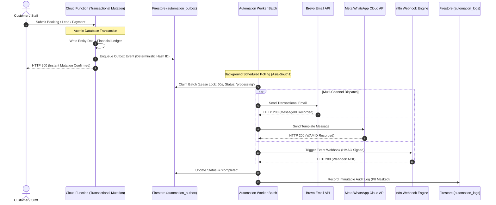

# PACKZEN 3.0 — MASTER AUTOMATION & EVENT CATALOG
## Comprehensive Inventory of Transactional Outbox Events, Producers & Dispatch Adapters

**Author:** Principal Automation Architect & Reliability Engineer  
**Project:** PackZen (`packzen-e7539`)  
**Pipeline Runtime:** Cloud Functions (Node.js 22 - `asia-south1`)  
**Channels:** Brevo REST API, Meta WhatsApp Cloud API, n8n Webhook  
**Guarantees:** At-Least-Once Delivery, Idempotent Processing, Zero PII Leakage

---

## 1. AUTOMATION PIPELINE ARCHITECTURE



---

## 2. COMPLETE CATALOG OF SUPPORTED EVENTS

| Event Name | Division | Triggering Action | Producer Function | Primary Channel | Priority |
|---|---|---|---|---|---|
| `lead.created` | All | Inbound lead received via web form or assistant | `emitLeadCreatedTx` | Email + WhatsApp | Normal |
| `lead.qualified` | All | Advisor verifies customer move/service details | `emitLeadQualifiedTx` | WhatsApp | Normal |
| `lead.assigned` | All | Advisor assigned to inbound lead | `emitLeadAssignedTx` | Email (Staff) | High |
| `lead.sla_breach` | All | Inbound lead uncontacted for >15 minutes | `emitLeadSlaBreachTx` | Email (Escalation) | Urgent |
| `booking.created` | Logistics | Customer completes booking checkout | `emitBookingCreatedTx` | Email + WhatsApp | High |
| `booking.confirmed` | Logistics | Advance payment captured by Razorpay | `emitBookingConfirmedTx` | Email + WhatsApp | High |
| `booking.assigned` | Logistics | Driver and vehicle assigned by ops | `emitBookingAssignedTx` | WhatsApp + SMS | High |
| `booking.completed` | Logistics | Job finished & OTP verified on delivery | `emitBookingCompletedTx` | Email + WhatsApp | High |
| `payment.received` | All | Razorpay webhook / capture verification | `emitPaymentReceivedTx` | Email (Receipt) | High |
| `project.created` | Digital | PackZen Digital project approved & created | `emitProjectCreatedTx` | Email + Webhook | High |
| `project.milestone_updated` | Digital | Milestone progress / sign-off updated | `emitProjectMilestoneUpdatedTx`| Email + Webhook | High |
| `home_service.requested` | Home Services| Customer reserves AC / appliance slot | `emitHomeServiceRequestedTx` | WhatsApp + Webhook | High |
| `partner.assigned` | Home Services| Technician dispatched for inspection | `emitPartnerAssignedTx` | WhatsApp | High |
| `daily.summary` | Overhead | Scheduled 07:00 IST executive briefing | `emitDailySummaryTx` | Email (Owner) | Normal |
| `workflow.stage_changed` | All | Entity transitions workflow state machine | `workflow-engine.js` | Webhook (n8n) | Normal |

---

## 3. EVENT PAYLOAD SCHEMAS & TEMPLATES

### 3.1 `lead.assigned`
- **Trigger:** Assigned sales advisor to new inbound inquiry.
- **Payload:**
  ```json
  {
    "leadId": "lead_99",
    "advisorId": "adv_suresh",
    "advisorName": "Suresh Sharma",
    "advisorEmail": "suresh@packzenblr.in",
    "customerName": "Priya Nair",
    "customerPhone": "9876501234",
    "service": "Household Shifting (3BHK)",
    "division": "logistics"
  }
  ```
- **Email Subject:** `Lead Assignment: Priya Nair (logistics) | PackZen Operations`
- **Recipient:** Assigned advisor (`suresh@packzenblr.in`).

### 3.2 `lead.sla_breach`
- **Trigger:** Lead in `"new"` status exceeds 15 minutes uncontacted.
- **Payload:**
  ```json
  {
    "leadId": "lead_102",
    "customerName": "Rohan Patel",
    "customerPhone": "9123456789",
    "elapsedMinutes": 45,
    "division": "home_services",
    "service": "AC Deep Clean"
  }
  ```
- **Email Subject:** `⚠️ URGENT: Uncontacted Lead SLA Breach (lead_102) | PackZen Operations`
- **Recipients:** Executive Operations distribution list.

### 3.3 `daily.summary`
- **Trigger:** Scheduled daily owner executive briefing.
- **Payload:**
  ```json
  {
    "date": "2026-11-19",
    "totalLeads": 14,
    "activeJobs": 6,
    "grossCollections": 85000,
    "outstandingReceivables": 22000
  }
  ```
- **Email Subject:** `PackZen Daily Business Summary — 2026-11-19 | Executive Report`
- **Recipient:** Verified Owner address.

### 3.4 `project.created`
- **Trigger:** Verified owner initiates PackZen Digital client contract.
- **Payload:**
  ```json
  {
    "projectId": "proj_101",
    "businessName": "Zenith Retail",
    "clientName": "Arjun Rao",
    "clientEmail": "arjun@zenith.in",
    "packageName": "Growth E-Commerce",
    "totalAmount": 45000,
    "paidAmount": 22500,
    "balanceDue": 22500
  }
  ```
- **Email Subject:** `Welcome to PackZen Digital — Zenith Retail Project Kick-off`
- **Recipient:** Client email (`arjun@zenith.in`).

---

## 4. RELIABILITY & CIRCUIT-BREAKER POLICIES

1. **Lease Locking:**
   Workers claim events by setting `status: "processing"`, `claimedBy: workerId`, and `leaseExpiresAtMs: now + 60000`. If a worker crashes, the lease expires and another worker safely recovers the job without data loss.
2. **Exponential Backoff:**
   $$\text{nextRetryAt} = \text{now} + (1000 \times 2^{\text{attempts}})$$
   (1s, 2s, 4s, 8s, 16s). Maximum 5 attempts.
3. **Dead-Letter Queue:**
   After 5 unsuccessful attempts or upon receiving an un-retryable HTTP 400 error, the event transitions to `"dead_letter"`, logging the error and alerting the Owner Console.
4. **Circuit Breaking for Third Parties:**
   If Brevo, Meta WhatsApp, or n8n encounters 5 consecutive failures, the adapter switches to `CIRCUIT_BROKEN`, deferring downstream events in `adapter_pending` state without exhausting retry limits.
