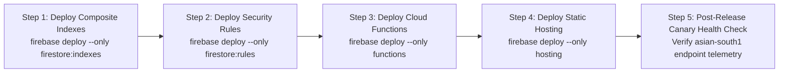

# PACKZEN 3.0 — PRODUCTION DEPLOYMENT READINESS & ROLLBACK PLAN
## Pre-Deployment Verification, Release Procedures, Canary Gates & Rollback Protocols

**Author:** Principal Reliability Engineer & Release Manager  
**Project:** PackZen (`packzen-e7539`)  
**Production Domain:** [https://packzenblr.in](https://packzenblr.in)  
**Firebase CLI Version:** `firebase-tools@latest`  
**Deployment Region:** `asia-south1` (Bengaluru / Mumbai)  
**Status:** READY FOR STAGED RELEASE (Pending User Authorization)

---

## 1. PRE-DEPLOYMENT READINESS CHECKLIST

| Gate | Check Item | Verification Status | Remediation / Note |
|---|---|---|---|
| **Gate 1** | Local Git Baseline Cleanliness | ✅ VERIFIED | Head is `0c3f9126`. No unauthorized commits or branch drifts. |
| **Gate 2** | Full Test Regression Suite | ✅ 63/63 PASSED | 100% green pass rate across all historical and Phase 4 test suites. |
| **Gate 3** | Rollback Asset Integrity | ✅ VERIFIED | `firebase.rollback.json`, `firestore.rules.prod_backup`, `functions_prod_backup/` present. |
| **Gate 4** | Composite Indexes Config | ✅ READY | `firestore.indexes.json` defined and registered in `firebase.json`. |
| **Gate 5** | Firestore Security Rules | ✅ READY | `firestore.rules` prohibits client-side writes to `/projects`, `/automation_outbox`, `/workflow_history`, and `/ledger`. |
| **Gate 6** | Payment Isolation Invariant | ✅ VERIFIED | `move-payment.js`, `catalog-booking.js`, and `balance-payment.js` remain untampered. |
| **Gate 7** | External Adapter Credentials | ⚠️ PENDING SECRETS | Brevo, WhatsApp, and n8n production API keys must be set in Firebase Config prior to enabling live workers. |

---

## 2. PRODUCTION RELEASE SEQUENCE (ORDER OF DEPLOYMENT)

When explicitly authorized by the project owner, deployment must proceed in the following strict order:



### Step 1: Deploy Firestore Composite Indexes
Indexes must build before new queries are executed by live traffic:
```bash
firebase deploy --only firestore:indexes --project packzen-e7539
```
*Wait until Firebase Console displays all 9 composite indexes in `Ready` state.*

### Step 2: Deploy Firestore Security Rules
Lock down write access on all collections:
```bash
firebase deploy --only firestore:rules --project packzen-e7539
```

### Step 3: Deploy Cloud Functions (Node.js 22 - `asia-south1`)
Deploy administrative callables, outbox producers, workflow state machines, and scheduled workers:
```bash
firebase deploy --only functions --project packzen-e7539
```

### Step 4: Deploy Web Hosting Assets
Deploy public website and administrative console:
```bash
firebase deploy --only hosting --project packzen-e7539
```

### Step 5: Post-Deployment Smoke Test & Telemetry
1. Log into `https://packzenblr.in/admin.html#owner`.
2. Verify Executive Overview cards render without NaN or undefined values.
3. Click `🟢 System Health` button to verify outbox worker latency and adapter health.
4. Execute `pzEco.openCustomer360()` on a known test customer.

---

## 3. ZERO-DOWNTIME EMERGENCY ROLLBACK PROTOCOL

In the event of an unexpected regression, authentication block, or provider timeout:

### Phase A: Instant Hosting Rollback (< 30 seconds)
Revert the frontend immediately to the last known production release:
```bash
# Using Firebase Hosting Release History
firebase hosting:clone packzen-e7539:previous packzen-e7539:live
```

### Phase B: Security Rules Rollback (< 60 seconds)
Restore the backed-up production security rules:
```bash
cp firestore.rules.prod_backup firestore.rules
firebase deploy --only firestore:rules --project packzen-e7539
```

### Phase C: Cloud Functions Rollback (< 3 minutes)
Deploy the pristine `functions_prod_backup` snapshot:
```bash
firebase deploy --only functions --project packzen-e7539 --source functions_prod_backup
```

---

## 4. RELEASE AUTHORIZATION GATE

> [!IMPORTANT]
> **Status: Awaiting Explicit User Authorization.**
> No deployment commands have been executed. The platform remains completely isolated locally.
