# PACKZEN 3.0 — MASTER ARCHITECTURE SPECIFICATION
## The Unified Operating System for Multi-Division Commerce & Operations

**Author:** Principal Software Architect & Staff Systems Engineer  
**Project:** PackZen (`packzen-e7539`)  
**Production Domain:** [https://packzenblr.in](https://packzenblr.in)  
**Operating Region:** `asia-south1` (Bengaluru / Mumbai)  
**Status:** IMPLEMENTED LOCALLY (Pending Deployment Authorization)  
**Baseline Git Commit:** `0c3f91264c123689626c59bce2cf4c3ae63ea25a`  
**Regression Test Status:** 63/63 Suites Passing (100% Green)

---

## 1. EXECUTIVE VISION & OPERATING PHILOSOPHY

PackZen 3.0 consolidates three previously distinct business verticals into **one parent brand, one unified website, and one integrated event-driven technology platform**:

```
                       ┌────────────────────────────────────────────────────────┐
                       │               PACKZEN 3.0 UNIFIED PLATFORM             │
                       │               Parent Brand: packzenblr.in              │
                       └───────────────────────────┬────────────────────────────┘
                                                   │
        ┌──────────────────────────────────────────┼──────────────────────────────────────────┐
        ▼                                          ▼                                          ▼
┌────────────────────────┐             ┌────────────────────────┐             ┌────────────────────────┐
│   PACKZEN LOGISTICS    │             │ PACKZEN HOME SERVICES  │             │    PACKZEN DIGITAL     │
│   Household Shifting   │             │ AC Deep Clean / Repair │             │ High-Converting Sites  │
│   Office Relocation    │             │ Appliance Maintenance  │             │ E-Commerce & Growth    │
│   Vehicle Coordination │             │ Verified Tech Partners │             │ Care Plans & Retainers │
└───────────┬────────────┘             └───────────┬────────────┘             └───────────┬────────────┘
            │                                      │                                      │
            └──────────────────────────────────────┴──────────────────────────────────────┘
                                                   │
                                                   ▼
                       ┌────────────────────────────────────────────────────────┐
                       │         CROSS-DIVISION INTEGRATION FOUNDATION          │
                       │   - Unified Customer 360 & Single Identity (Phone/UID) │
                       │   - Transactional Outbox (Brevo, WhatsApp, n8n)        │
                       │   - Authoritative Double-Entry Financial Ledger (P&L)  │
                       │   - Multi-Division Workflow State Machines             │
                       │   - Executive Daily Operating Console (Owner)          │
                       └────────────────────────────────────────────────────────┘
```

### Core Architecture Principles:
1. **Zero Entity Duplication:** A single customer record (`users` collection) anchors all cross-division interactions, whether the customer books a 3BHK household relocation, books an AC jet service, or contracts an e-commerce website redesign.
2. **Authoritative Financial Principle:** Customer Collections $\neq$ Contribution Margin $\neq$ Net Operating Profit.
   $$\text{Net Collections} = \max(0, \text{Gross Collections} - \text{Refunds})$$
   $$\text{Direct Costs} = \text{Partner Payouts} + \text{Materials} + \text{Gateway Fees} + \text{Discounts}$$
   $$\text{Contribution Margin} = \text{Net Collections} - \text{Direct Costs}$$
   $$\text{Net Operating Profit} = \text{Contribution Margin} - \text{Shared Opex}$$
3. **At-Least-Once Transactional Outbox:** Zero third-party API calls (Brevo, Meta WhatsApp Cloud API, n8n webhook) occur inside database transaction blocks. All business events write an outbox record in `automation_outbox` within the atomic transaction. Dedicated background workers lease, dispatch, retry, and dead-letter events safely.
4. **Zero Live Deployment Drift:** All Phase 4 implementation is completed locally with 100% test regression pass rates. Production cloud secrets, DNS records, live database documents, and Git commits remain un-mutated until explicit customer authorization.

---

## 2. HIGH-LEVEL SYSTEM TOPOLOGY

```mermaid
flowchart TD
    subgraph ClientLayer ["Client Presentation Layer (Public & Staff)"]
        Web["Customer Web Portal (Vanilla JS/PWA)"]
        Admin["Admin Ecosystem (admin.html + admin-ecosystem.js)"]
        Advisor["Advisor & Crew Portal (crew app)"]
    end

    subgraph FirebaseHosting ["Firebase CDN / Hosting"]
        StaticAssets["Static HTML/CSS/JS Assets"]
        RollbackConfig["Rollback Snapshot (firebase.rollback.json)"]
    end

    subgraph CloudFunctions ["Serverless Compute (Node.js 22 - asia-south1)"]
        CallableGateway["Authorized Callables (isCallerAdmin RBAC)"]
        AsyncWorker["Automation Worker (Scheduled / Batch Worker)"]
        UnifiedCommand["Unified Command Engine (unified-command.js)"]
        WorkflowEngine["Workflow Orchestrator (workflow-engine.js)"]
        AnalyticsEngine["Analytics & Forecasting Engine (analytics-engine.js)"]
        HealthMonitor["Observability Monitor (health-monitor.js)"]
    end

    subgraph FirestoreCluster ["Cloud Firestore Database"]
        ColUsers["users / customers"]
        ColBookings["bookings (Logistics & Home Services)"]
        ColProjects["projects (Digital Contracts)"]
        ColLeads["leads (Inbound Inquiries)"]
        ColLedger["ledger (Categorized Financial Records)"]
        ColPartners["partners (Drivers & Technicians)"]
        ColOutbox["automation_outbox (Transactional Queue)"]
        ColWorkflowHistory["workflow_history (Audit Trail)"]
    end

    subgraph ExternalChannels ["External Dispatch Adapters"]
        Brevo["Brevo API (Transactional Email)"]
        WhatsApp["Meta WhatsApp Cloud API"]
        N8N["n8n Webhook Automation"]
        Razorpay["Razorpay Gateway (Payments & Verification)"]
    end

    Web --> StaticAssets
    Admin --> StaticAssets
    Admin --> CallableGateway
    CallableGateway --> UnifiedCommand
    CallableGateway --> WorkflowEngine
    CallableGateway --> AnalyticsEngine
    CallableGateway --> HealthMonitor
    CallableGateway --> FirestoreCluster
    AsyncWorker --> ColOutbox
    AsyncWorker --> Brevo
    AsyncWorker --> WhatsApp
    AsyncWorker --> N8N
    CallableGateway --> Razorpay
```



---

## 3. UNIFIED SUBSYSTEM SPECIFICATIONS

### 3.1 Unified Command Center & Action Stream (Phase 4B)
- **Module:** `functions/unified-command.js`
- **Callable Endpoints:**
  - `adminGetExecutiveOverview`: Generates authoritative real-time KPIs, division breakdowns, P&L calculations, run-rate velocity, and outstanding liabilities.
  - `adminGetCustomerUnifiedProfile`: Resolves customer identity by UID, phone, or email, aggregating cross-division history with strict PII masking for non-admin callers.
  - `adminGetOwnerActionStream`: Scans for critical SLA breaches (>15 min unassigned leads), digital project milestone delays, high outstanding balances (>₹10,000), and automation dead-letters.

### 3.2 Cross-Division Automation Engine (Phase 4C)
- **Modules:** `functions/automation-producers.js`, `functions/automation-dispatcher.js`, `functions/automation-outbox.js`
- **Supported Cross-Division Events:**
  - `lead.created`, `lead.qualified`, `lead.assigned`, `lead.sla_breach`
  - `booking.created`, `booking.confirmed`, `booking.assigned`, `booking.completed`
  - `payment.received` (Advance, Balance, Milestone)
  - `project.created`, `project.milestone_updated`
  - `home_service.requested`, `partner.assigned`
  - `daily.summary`, `workflow.stage_changed`
- **Reliability SLA:** Exponential backoff ($1\text{s}, 2\text{s}, 4\text{s}, 8\text{s}, 16\text{s}$), 60s lease locks, max 5 attempts before dead-lettering, zero duplicate emails on retry.

### 3.3 Multi-Division Workflow State Machines (Phase 4D)
- **Module:** `functions/workflow-engine.js`
- **State Pipelines:**
  - **Logistics (11 stages):** `lead` $\rightarrow$ `qualified` $\rightarrow$ `survey` $\rightarrow$ `quoted` $\rightarrow$ `booked` $\rightarrow$ `advance_paid` $\rightarrow$ `assigned` $\rightarrow$ `in_transit` $\rightarrow$ `delivered` $\rightarrow$ `balance_collected` $\rightarrow$ `reviewed`.
  - **Home Services (10 stages):** `lead` $\rightarrow$ `qualified` $\rightarrow$ `service_requested` $\rightarrow$ `technician_assigned` $\rightarrow$ `inspected` $\rightarrow$ `quoted` $\rightarrow$ `approved` $\rightarrow$ `serviced` $\rightarrow$ `paid` $\rightarrow$ `feedback`.
  - **Digital (11 stages):** `lead` $\rightarrow$ `discovery` $\rightarrow$ `proposal` $\rightarrow$ `approved` $\rightarrow$ `advance_paid` $\rightarrow$ `kickoff` $\rightarrow$ `development` $\rightarrow$ `review` $\rightarrow$ `delivered` $\rightarrow$ `balance_paid` $\rightarrow$ `maintenance`.
- **Audit Immutability:** Every stage transition creates an append-only document in `workflow_history`. Jumping stages requires explicit `overrideReason` and verified owner/admin credentials.

### 3.4 Advanced Analytics & Mathematical Forecasting (Phase 4E)
- **Module:** `functions/analytics-engine.js`
- **Strict Segregation:**
  - `actuals`: Raw historical records (Total Leads, Bookings, Projects, Ledger P&L, Receivables).
  - `calculatedMetrics`: Marketing source attribution (Google, WhatsApp, Referral, Direct), cohort conversion rates, unit economics (AOV, Direct Cost, Contribution per job), repeat customer retention rates.
  - `forecasts`: Transparent run-rate based on mathematical daily velocity ($\text{daily collection velocity} \times 30$) and historical division-weighted pipeline conversion. Zero synthetic or fabricated figures.

### 3.5 System Observability & Governance (Phase 4F)
- **Module:** `functions/health-monitor.js`
- **Metrics Collected:**
  - Outbox backlog, dead-letter count, failed count, processed today.
  - Upstream adapter health (Brevo REST, Meta WhatsApp Cloud API, n8n webhook circuit state).
  - Security configuration compliance (App Check monitoring, Firestore rules enforcement, client write prohibition).
- **Alert Levels:** `HEALTHY` (0 dead letters), `WARNING` ($\ge 1$ dead letter or $>5$ failures), `CRITICAL` ($\ge 5$ dead letters or $\ge 20$ client errors).

---

## 4. SECURITY & PERMISSIONS ARCHITECTURE

1. **Role-Based Access Control (RBAC):**
   - Verified Owner / Admin: Access to all administrative callables (`isCallerAdmin`), ledger records, and customer PII.
   - Operations / Advisor: Can view and advance assigned leads and bookings.
   - Crew / Technician: Can only view assigned jobs and enter OTP completion tokens.
   - Customer: Can view and mutate only their own profile and bookings (`request.auth.uid == resource.data.customerUid`).
2. **Firestore Rules Enforcement (`firestore.rules`):**
   - Direct client mutation prohibited for `/projects/{projectId}`.
   - Direct client mutation prohibited for `/automation_outbox/{id}`.
   - Direct client mutation prohibited for `/workflow_history/{id}`.
   - Direct client mutation prohibited for `/ledger/{id}`.
3. **App Check & Rate Limiting:**
   - App Check monitoring enabled for public callable endpoints.
   - Strict sliding-window rate limiters enforced on payment order creation, OTP completion, and public lead submissions.
