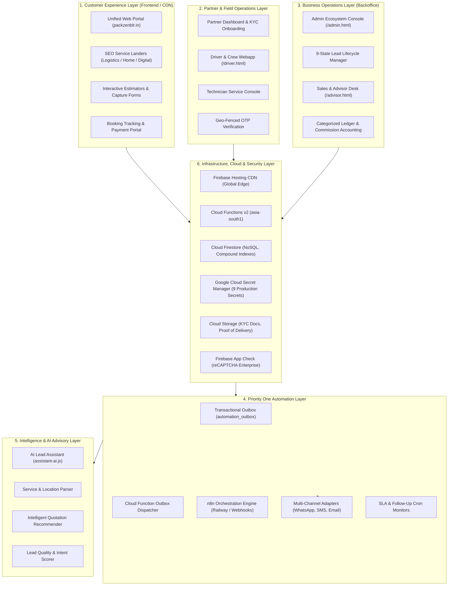
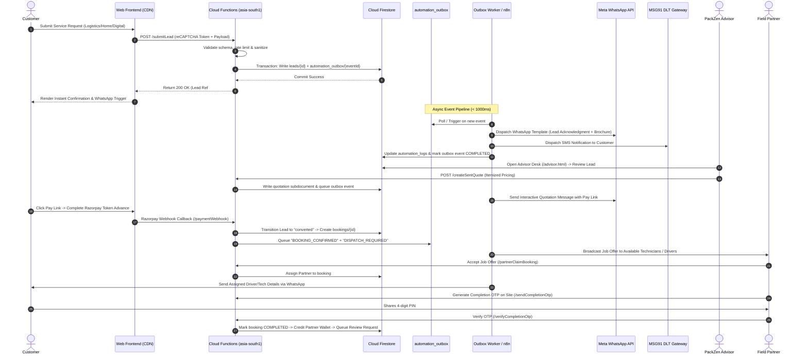

# PACKZEN 3.0 — Platform Architecture Specification
## Multi-Service Marketplace, Automation-First Engine & Business Operating System

**Document Version:** 3.0.0  
**Status:** Approved Architectural Blueprint  
**Target Environment:** `packzen-e7539` (Google Cloud / Firebase `asia-south1`)  
**Production Domain:** https://packzenblr.in  
**Operating Division Scope:** Logistics, Home Services, Digital Solutions  
**Target City:** Bengaluru (with intercity corridors)

---

## 1. System Vision & Architectural Principles

PackZen 3.0 is a unified, automation-first multi-service marketplace and business operating system engineered for high-trust urban operations. The system unifies three distinct operating divisions into a single resilient technological core while providing division-specialized workflows:

```
+-----------------------------------------------------------------------------------+
|                                PACKZEN 3.0 CORE                                   |
+------------------------------------+----------------------------------------------+
| 1. LOGISTICS (Packers & Movers)    | House Shifting, Vehicle Moving, Single Items |
| 2. HOME SERVICES (Technicians)     | AC Service/Gas, Appliance Repair, Cleaning   |
| 3. DIGITAL SOLUTIONS (Agency)      | High-Conversion Websites, SEO, Local Growth  |
+------------------------------------+----------------------------------------------+
```

### Core Architectural Tenets
1. **Zero-Trust Security & Explicit Boundaries:** Multi-tenant role-based access control (RBAC), secure claims verification, strict server-side authorization, and defense-in-depth protection of customer PII and financial records.
2. **Transactional Outbox for Guaranteed Automation:** Business mutations and event queuing execute atomically within Firestore transactions, ensuring zero lost events, zero zombie state, and at-least-once external delivery.
3. **Strict AI Advisory Boundaries:** AI assistants generate recommendations, extract entities, and draft quotes, but are structurally prohibited from autonomous financial mutations, booking confirmation, or partner payouts.
4. **Resilient Dual-Speed Architecture:** Real-time customer experience powered by Firebase CDN and serverless micro-functions, coupled with scalable event-driven orchestration powered by n8n and asynchronous webhook pipelines.
5. **Non-Destructive Evolution:** Strict backward-compatibility with live production assets (`functions/`, `firestore.rules`, Razorpay integration, Google Maps distance validation, and SEO routes).

---

## 2. Six-Layer Logical Architecture



---

### Layer 1: Customer Experience Layer
- **Unified Storefront & Localized Landers:** 30+ optimized landing pages catering to Bengaluru localities (Koramangala, HSR Layout, Indiranagar, Whitefield, etc.) with JSON-LD microdata for local SEO and Google AEO discovery.
- **Dynamic Instant Estimator:** Real-time distance and inventory pricing engine with elevation, truck tier, packing material, and insurance calculation.
- **Lead Capture Micro-Forms:** Progressive profiling forms that capture high-intent inquiries and push structured payloads directly to serverless endpoints.
- **Self-Service Customer Portal:** Mobile-first tracking view providing real-time booking status, assigned crew profile, live tracking links, invoice downloads, and Razorpay payment links.

### Layer 2: Partner & Field Operations Layer
- **Partner Onboarding & KYC:** Partner registration portal (`partner-register.html`, `partner-dashboard.html`) collecting Aadhaar, Driving License, GSTIN, vehicle RC, and bank details stored securely in Cloud Storage.
- **Crew & Driver Web Console:** Streamlined mobile PWA interface (`driver.html`) optimized for low-bandwidth field use.
- **Live Job Offer Broadcasting:** Real-time push of dispatch offers with pickup locality, estimated payout, and vehicle requirement.
- **Zero-Trust Service Completion:** Dual-PIN OTP verification (`completion-otp.js`) ensuring service completion is verified by the end customer before partner balance release.

### Layer 3: Business Operations Layer
- **Operations Cockpit (`admin.html`):** Real-time monitoring of all 3 business divisions with instant metric counters (Active Leads, In-Transit Moves, Pending Services, Daily Revenue).
- **9-State Lead Lifecycle Manager:** Enforces strict state transitions across all divisions:
  `new` -> `contacted` -> `qualified` -> `quotation_pending` -> `quotation_sent` -> `negotiation` -> `converted` -> `lost` -> `closed`.
- **Advisor Desk (`advisor.html`):** Multi-agent workstation enabling staff to handle customer calls, calculate manual quotations, send payment links, and assign field teams.
- **Financial Ledger & Reconciliation:** Categorized ledger tracking gross collections, vendor payouts, gateway fees, and platform net revenue.

### Layer 4: Priority One Automation Layer
- **Transactional Outbox Engine:** Guaranteed delivery mechanism where state changes in Firestore atomically generate outbox tasks.
- **n8n Orchestration Bridge:** Dedicated workflow router handling complex branching logic, multi-stage reminders, and webhook coordination.
- **Multi-Channel Dispatch Adapters:**
  - *WhatsApp Business Cloud API:* High-engagement transactional templates with interactive buttons.
  - *MSG91 SMS:* Transactional DLT-approved SMS templates for OTPs and immediate critical alerts.
  - *Brevo (Sendinblue):* Branded responsive transactional emails for detailed quotations, contracts, and tax invoices.
- **SLA & Escalation Engine:** Background schedulers executing 15-minute response checks, 2-hour quote follow-ups, and 24-hour reminder cascades.

### Layer 5: Intelligence & AI Advisory Layer
- **AI Lead Assistant:** Analyzes customer inquiries across WhatsApp, email, and web chat to extract structured requirements (origin, destination, BHK size, AC tonnage, tech stack requirements).
- **Strict Advisory Guardrails:** AI generates structured draft suggestions (`quote_draft`, `suggested_reply`, `risk_flag`) stored in Firestore for human approval. The AI is prevented from executing database writes to live financial records.
- **Dynamic Urgency Scoring:** Evaluates move dates, lead source, and interaction frequency to assign prioritization scores (1-100) to incoming leads.

### Layer 6: Infrastructure, Cloud & Security Layer
- **Regional Execution:** All Cloud Functions and Firestore instances reside in `asia-south1` (Mumbai) to guarantee lowest latency for Indian users.
- **Secret Management:** Sensitive credentials (Razorpay keys, MSG91 auth, Brevo API key, WhatsApp tokens) reside exclusively in Google Cloud Secret Manager.
- **App Check & CORS Hardening:** Web clients authenticate against Firebase App Check, preventing scraper abuse and unauthorized direct API invocations.

---

## 3. End-to-End Component Interaction & Data Flow



---

## 4. Existing vs. New Services Matrix

| Component | Current Live State (`0c3f912`) | PackZen 3.0 Architectural Extension | Target Location |
|---|---|---|---|
| **Public Storefront** | Static HTML + Vanilla JS with Firebase Hosting CDN | Retain ultra-fast static core; enhance with JSON-LD microdata, dynamic estimator widgets, and PWA capabilities | `public/*.html`, `public/css/`, `public/js/` |
| **Lead Ingestion** | `functions/leads.js` (`submitLead`) | Multi-division schema parser, source tracking, and atomic outbox dispatch | `functions/leads.js` |
| **Outbox Engine** | Non-existent (direct synchronous notifications) | Transactional Outbox Collection (`automation_outbox`) with idempotent Cloud Function dispatcher | `functions/automation-outbox.js` |
| **Automation Flow** | Hardcoded scripts in `notification-service.js` | Modular n8n workflow integration via authenticated webhook endpoints | `functions/automation-bridge.js` + n8n host |
| **Messaging Channels** | Brevo email client + MSG91 SMS triggers | Unified Multi-Channel Gateway: WhatsApp Cloud API, MSG91 DLT, Brevo v3 | `functions/channel-whatsapp.js`, `functions/channel-sms.js` |
| **Lead CRM** | Basic table in `admin.html` | Full 9-stage auditable pipeline with SLA countdowns and division filters | `public/leads-app/`, `public/admin-ecosystem.js` |
| **Quotation Engine** | Static catalog pricing (`catalog-pricing.js`) | Dynamic 3-division quote builder with dynamic margins, GST, and interactive links | `functions/quotation-engine-v3.js` |
| **Partner Portal** | Basic driver console (`driver.html`) | Full KYC, vehicle/crew management, live job claim queue, and geo-fenced check-in | `public/partner-*.html`, `functions/partner-*.js` |
| **Service Verification** | 4-digit OTP via `completion-otp.js` | Enhanced dual-factor completion: OTP verification + photo proof upload to Cloud Storage | `functions/completion-otp.js` |
| **Financial Ledger** | Basic `recordBalanceCollection` | Categorized double-entry ready ledger: gross bookings, payouts, operational expenses, net profit | `functions/ledger-service.js` |
| **AI Capabilities** | Rule-based lead scorer in `lead-quality.js` | Advisory AI Assistant (`assistant-ai.js`) powered by Gemini Flash for lead summarization and quote drafting | `functions/assistant-ai.js` |

---

## 5. Integration Interfaces & API Boundaries

### External Third-Party Gateways
1. **Meta WhatsApp Cloud API / Gupshup / WATI:**
   - Transport: HTTPS REST with Bearer Authentication.
   - Credentials: Encrypted in Google Cloud Secret Manager (`WHATSAPP_API_TOKEN`, `WHATSAPP_PHONE_NUMBER_ID`).
   - Inbound Webhooks: Validated with HMAC-SHA256 signature against `WHATSAPP_APP_SECRET`.
2. **MSG91 SMS Gateway:**
   - Transport: HTTPS POST to `api.msg91.com/api/v5/flow/`.
   - Credentials: `MSG91_AUTH_KEY`, `MSG91_SENDER_ID`.
   - Compliance: 100% compliant with Indian Telecom Commercial Communications Customer Preference Regulations (TCCCPR) via approved DLT template IDs.
3. **Brevo (Sendinblue):**
   - Transport: HTTPS REST via `@getbrevo/brevo` SDK.
   - Credentials: `BREVO_API_KEY`.
   - Output: Transactional email with DKIM/SPF alignment on `packzenblr.in`.
4. **Razorpay Payments:**
   - Transport: Standard Checkout API + Server-side Order Generation.
   - Credentials: `RAZORPAY_KEY_ID`, `RAZORPAY_KEY_SECRET`.
   - Webhooks: Authenticated using `crypto.createHmac('sha256', secret).update(body).digest('hex')`.
5. **Google Maps Platform:**
   - Capabilities: Places Autocomplete, Geocoding, Distance Matrix API.
   - Credentials: Server-side restricted API key (`MAPS_API_KEY`).

---

## 6. Architectural Governance & Non-Functional Requirements

| Metric | Target SLA / Standard | Implementation Mechanism |
|---|---|---|
| **P95 Page Load Time** | < 1.2 seconds across 4G mobile | Edge caching via Firebase Hosting CDN, zero large render-blocking frameworks |
| **Lead Ingestion Latency** | < 450 ms end-to-end | Serverless v2 Cloud Functions, in-memory validation, single-roundtrip Firestore write |
| **Outbox Dispatch SLA** | 99.9% processed within 15 seconds | Event-driven trigger on `automation_outbox` write with cron backup |
| **Data Durability & Isolation** | Zero cross-tenant data leaks | Firestore Security Rules enforcing user UID matching and strict admin email verification |
| **Zero-Downtime Releases** | 100% continuous uptime during deploys | Atomic Hosting releases and backward-compatible Firestore schemas |
| **Idempotency Guarantee** | Exactly-once business side effects | SHA-256 hashed idempotency keys checked before any external dispatch or ledger entry |
