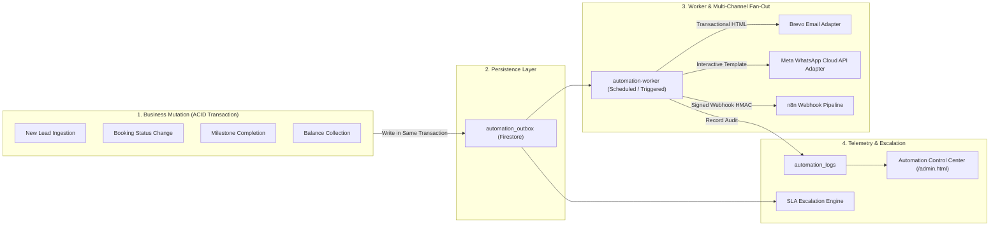
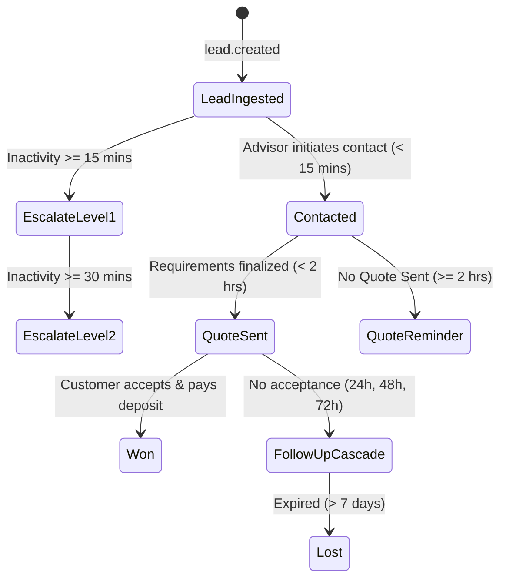

# PACKZEN 3.0 — CROSS-DIVISION AUTOMATION ROADMAP
## Event-Driven Orchestration, Multi-Channel Dispatch & Escalation Framework

**Document Version:** 4.0.0  
**Status:** Approved Master Automation Specification  
**Target Environment:** `functions/automation-*.js`, Brevo API, Meta WhatsApp Cloud API, n8n Engine  
**Scope:** PackZen Logistics, PackZen Home Services, PackZen Digital Solutions

---

## 1. Automation Architecture & Tenets

PackZen 3.0 automation is built on an enterprise-grade **Transactional Outbox Architecture**. By decoupling business state transitions from external messaging I/O, the system guarantees zero lost events, deterministic retry handling, and complete resilience against third-party API downtime.



---

## 2. Comprehensive Event Catalog

Every automation event follows a strict naming convention: `<domain>.<entity>.<action>`. All payloads must adhere to server-side schema allowlists with sensitive secrets and authentication tokens strictly redacted.

| Event Name | Trigger Source | Target Channels | Intended Recipients | Key Payload Attributes |
|---|---|---|---|---|
| `lead.created` | Public web forms, inbound WhatsApp, phone call | WhatsApp, Email, n8n | Customer, Internal Staff | `leadId`, `division`, `customerName`, `phone`, `urgencyScore`, `requirements` |
| `lead.assigned` | Admin Command Center, auto-assignment rule | WhatsApp, n8n | Assigned Advisor | `leadId`, `advisorName`, `advisorPhone`, `customerName`, `requirements` |
| `lead.sla_breach` | Scheduled SLA monitor (15m inactivity) | WhatsApp, n8n | Operations Manager, Owner | `leadId`, `elapsedMinutes`, `customerName`, `division` |
| `booking.created` | Customer booking portal, advisor reservation | WhatsApp, Email, n8n | Customer, Operations | `bookingId`, `flow`, `customerName`, `scheduledDate`, `totalAmount`, `advancePaid` |
| `booking.partner_assigned` | Dispatch desk, driver auto-match | WhatsApp | Partner / Crew, Customer | `bookingId`, `partnerName`, `partnerPhone`, `vehiclePlate`, `scheduledTime` |
| `booking.otp_generated` | Arrival at pickup/service location | WhatsApp, SMS | Customer | `bookingId`, `maskedOtp`, `partnerName`, `locationAddress` |
| `booking.completed` | Valid OTP submission via `/driver.html` | WhatsApp, Email, n8n | Customer, Partner, Accounts | `bookingId`, `completionTime`, `totalCollected`, `invoiceUrl`, `ratingLink` |
| `project.created` | Admin command center (`createDigitalProject`) | Email, n8n | Client, Digital Lead | `projectId`, `clientName`, `clientEmail`, `tier`, `totalAmount`, `milestones` |
| `project.milestone_updated`| Milestone marked complete/approved | Email, n8n | Client, Accounts | `projectId`, `clientName`, `milestoneId`, `milestoneTitle`, `status`, `balanceDue` |
| `payment.received` | Razorpay webhook, manual balance collection | Email, WhatsApp | Client, Accounts | `paymentRequestId`, `referenceId`, `amount`, `paymentMethod`, `newBalanceDue` |
| `partner.kyc_approved` | Partner management desk | WhatsApp, SMS | Partner | `partnerId`, `partnerName`, `activationDate`, `portalUrl` |

---

## 3. SLA Monitoring & Escalation Framework

Customer responsiveness is directly correlated with booking conversion. PackZen 3.0 enforces automated escalation schedules across all divisions:



### 3.1 Escalation Rules Matrix:

1. **Lead First-Response SLA (Target: < 15 minutes):**
   - **T+0m:** Lead ingested. Welcome WhatsApp sent to customer; Slack/WhatsApp push to primary advisor.
   - **T+15m:** If `leads.stage == 'new'`, trigger `lead.sla_breach`. WhatsApp push sent to Operations Team Lead.
   - **T+30m:** If still uncontacted, auto-reassign lead to on-duty backup advisor and notify Business Owner.

2. **Quotation Follow-Up Cascade (Target: < 2 hours):**
   - **T+2h:** If `leads.stage == 'quotation_pending'`, trigger automated advisor prompt with pre-calculated pricing.
   - **T+24h:** If `quotation_sent` with no customer response, dispatch interactive WhatsApp template with quick-reply buttons ("Book Move", "Request Callback", "Need Customization").
   - **T+72h:** Dispatch Brevo email highlighting PackZen moving guarantees, insurance coverage, and customer testimonials.

3. **Digital Milestone Review Escalation:**
   - **T+0h:** Milestone completed by engineering team. Client notified via email with review link.
   - **T+48h:** Automated WhatsApp reminder sent to client if milestone remains pending review.
   - **T+96h:** Alert triggered in Admin Command Center to schedule executive review call.

---

## 4. Multi-Channel Adapter Architecture

### 4.1 Brevo (Sendinblue) Transactional Email Adapter
- **Protocol:** REST API v3 (`https://api.brevo.com/v3/smtp/email`).
- **Template Architecture:** Server-side rendered HTML templates adhering to responsive email standards, with dynamic personalization tags:
  - `lead_confirmation.html`
  - `quotation_estimate.html`
  - `project_created.html`
  - `project_milestone.html`
  - `tax_invoice.html`
- **Delivery Tracking:** Captures provider `messageId` and records it in `automation_logs`.

### 4.2 Meta WhatsApp Cloud API Adapter
- **Protocol:** Meta Graph API v21.0 (`https://graph.facebook.com/v21.0/${PHONE_NUMBER_ID}/messages`).
- **Compliance:** 100% pre-approved Meta WhatsApp Business Templates for business-initiated conversations:
  - `packzen_lead_welcome` (Marketing/Utility)
  - `packzen_move_confirmation` (Utility)
  - `packzen_driver_dispatch` (Utility)
  - `packzen_otp_verification` (Authentication)
  - `packzen_quote_followup` (Marketing)
- **Interactive Elements:** Uses quick-reply buttons and call-to-action buttons for seamless mobile booking and confirmation.

### 4.3 n8n Webhook & Multi-Step Workflow Adapter
- **Protocol:** Secure HTTPS POST to Railway-hosted n8n workflow cluster.
- **Security & Integrity:**
  - Every payload includes an `X-PackZen-Signature` header computed as:
    `HMAC-SHA256(payload, N8N_WEBHOOK_SECRET)`.
  - Payloads include a 5-minute validity timestamp and unique `eventId` for persistent replay deduplication.
- **Role of n8n in PackZen:**
  - Complex branching workflows (e.g., Google Calendar slot reservation, CRM synchronization).
  - External lead syndication (aggregating leads from third-party housing directories).
  - Long-running multi-day drip nurture sequences.

---

## 5. Resilience, Circuit-Breaking & Dead-Letter Handling

```
+-----------------------------------------------------------------------------------+
|                           OUTBOX DISPATCH FAULT TOLERANCE                         |
+-----------------------------------------------------------------------------------+
|  ATTEMPT 1: Immediate Execution                                                   |
|       |                                                                           |
|       +--> Success? ---> Status: 'completed', Log: 'success'                      |
|       |                                                                           |
|       +--> Transient Error (5xx, Timeout, 429)?                                   |
|               |                                                                   |
|               v                                                                   |
|  ATTEMPT 2: Backoff = 30 seconds (Exponential + Jitter)                           |
|       |                                                                           |
|       v                                                                           |
|  ATTEMPT 3: Backoff = 2 minutes                                                   |
|       |                                                                           |
|       v                                                                           |
|  ATTEMPT 4: Backoff = 10 minutes                                                  |
|       |                                                                           |
|       v                                                                           |
|  ATTEMPT 5: Backoff = 30 minutes                                                  |
|       |                                                                           |
|       +--> Still Failing? ---> Status: 'dead_letter'                               |
|                                     |                                             |
|                                     +--> Emit Admin Alert in Command Center       |
|                                     +--> Await Operator Manual Investigation      |
+-----------------------------------------------------------------------------------+
```

### Circuit Breaker Rules:
- If an adapter returns 5 consecutive HTTP 429 (Rate Limit) or 503 (Service Unavailable) errors within a 5-minute window, the adapter trips to `CIRCUIT_OPEN`.
- While `OPEN`, pending events for that adapter are deferred to `adapter_pending` without incrementing their retry counter.
- A synthetic canary probe is dispatched every 60 seconds; on 2 consecutive successes, the circuit resets to `CLOSED`.
