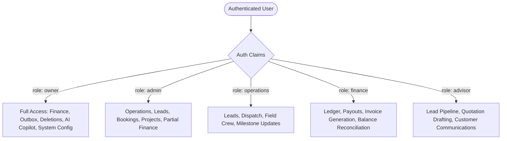

# PACKZEN 3.0 — UNIFIED OWNER COMMAND CENTER SPECIFICATION
## Centralized Operations Dashboard, Real-Time Telemetry & Multi-Division Management

**Document Version:** 4.0.0  
**Status:** Approved Master UI/UX & Operations Specification  
**Target Environment:** `public/admin.html`, `public/admin-ecosystem.js`, `public/admin-automation.js`  
**Host Application:** PackZen Business Administration Suite (`https://packzenblr.in/admin.html`)

---

## 1. Vision & Core Philosophy

The PackZen Owner Command Center is the centralized executive cockpit of PackZen 3.0. It provides the business owner and operational leadership with single-screen visibility across all three operating verticals—**PackZen Logistics**, **PackZen Home Services**, and **PackZen Digital Solutions**.

### Core Capabilities:
1. **Division-Agnostic Single Pane of Glass:** Switch seamlessly between an aggregated birds-eye view and dedicated division workspaces with zero page reloads.
2. **Sub-Second Real-Time Telemetry:** Instant notifications for urgent inbound inquiries, active in-transit moves, stuck field technicians, overdue digital milestones, and automation dead-letters.
3. **Action-Oriented Control:** Execute critical business mutations (lead assignment, quote approval, partner dispatch, manual retry, milestone sign-off, refund release) directly from contextual action sheets.
4. **Bandwidth-Optimized Data Architecture:** Hybrid state management balancing low-latency Firestore real-time listeners for active jobs with on-demand callable pagination for historical records.

---

## 2. Command Center Layout Architecture

```
+---------------------------------------------------------------------------------------------------------+
| [PACKZEN 3.0 LOGO]   COMMAND CENTER  |  GLOBAL DIVISION SWITCHER: [ALL | LOGISTICS | HOME | DIGITAL]  |
| Profile: Azhar (Owner)               |  Status: ONLINE (asia-south1)        | [AI COPILOT TRIGGER (✨)]|
+---------------------------------------------------------------------------------------------------------+
| [KPI 1: ACTIVE LEADS]   [KPI 2: JOBS IN FLIGHT]   [KPI 3: PENDING MILESTONES]  [KPI 4: TODAY'S REVENUE] |
| 14 Leads (3 Urgent)     8 In-Transit / Service    5 Deliverables Pending       ₹1,42,500 Gross Margin   |
+---------------------------------------------------------------------------------------------------------+
|                                    CRITICAL OPERATIONAL ALERT STREAM                                    |
| [!] DEAD-LETTER: Brevo bounce on booking BK_88291 [Review & Retry]                                      |
| [!] OVERDUE SLA: Digital project "Apex Solar" milestone M2 passed due date [Contact Client]             |
+-----------------------------------+---------------------------------------------------------------------+
| LEFT PANEL (Navigation & Filters) | MAIN WORKSPACE: CONTEXTUAL DIVISION TABS                            |
| --------------------------------- | ------------------------------------------------------------------- |
| > Overview & Operations           | [LEADS PIPELINE]  [DISPATCH & FLEET]  [PROJECTS]  [FINANCE & LEDGER]|
| > Automation Outbox (Phase 2D)    | ------------------------------------------------------------------- |
| > Revenue Intelligence            | Interactive Kanban or Dense Data Grid with real-time status badges, |
| > Partner & Crew Management       | multi-attribute search, quick-action dropdowns, and inline metrics. |
| > System Health & Audit Logs      |                                                                     |
+-----------------------------------+---------------------------------------------------------------------+
| FLOATING ACTION DOCK: [+ New Lead]  [+ Direct Booking]  [+ Digital Project]  [+ Record Ledger Expense]  |
+---------------------------------------------------------------------------------------------------------+
```

---

## 3. Division Switching Matrix

The global division switcher toggles the operational filter state `window.PACKZEN_CURRENT_DIVISION`:

| Mode | Active Entities Displayed | Metric Cards Aggregation | Primary Action Buttons |
|---|---|---|---|
| **ALL DIVISIONS** | Cross-division leads, active moves, scheduled repairs, digital milestones | Total Gross Margin, Total Open Leads, Total Active Jobs, System Dead-letters | `+ New Lead`, `+ General Expense`, `View Ledger` |
| **LOGISTICS** | Moving leads, vehicle allocations, active moves (`in_transit`), delivery OTPs | Active Moves, Trucks Dispatched, Logistics Daily Revenue, Pending Deliveries | `+ Moving Booking`, `Assign Crew`, `Dispatch Broadcast` |
| **HOME SERVICES** | Service leads, technician rosters, scheduled slots, completion OTPs | Scheduled Services, Active Techs, Home Daily Revenue, Completed Today | `+ Service Order`, `Assign Technician`, `Verify OTP` |
| **DIGITAL** | Digital leads, scoped proposals, active deliverables, milestone balances | Active Projects, Milestones Due, Digital Collections, Unpaid Balance | `+ Digital Project`, `Update Milestone`, `Collect Balance` |

---

## 4. Real-Time Telemetry & Metric Engine

### 4.1 Telemetry Counters
The command center recalculates and renders four real-time metric counters every 30 seconds (or immediately on Firestore snapshot):

1. **Active Leads Counter:**
   - Query: `leads` where `stage in ['new', 'contacted', 'qualified', 'quotation_pending']`
   - Highlighting: Flashes crimson if any lead has `urgencyScore >= 80` and was created > 15 minutes ago.
2. **Operations in Flight:**
   - Logistics: `bookings` where `division == 'logistics'` and `status in ['confirmed', 'assigned', 'in_transit']`.
   - Home Services: `bookings` where `division == 'home_services'` and `status in ['assigned', 'in_progress']`.
3. **Pending Milestone Deliverables:**
   - Query: `projects` where `status in ['active', 'in_progress', 'review']`. Displays count of milestones pending client review or overdue.
4. **Today's Financial Velocity:**
   - Query: `ledger` where `timestamp >= startOfToday` and `category == 'collection'`.
   - Displays gross receipts with real-time margin breakdown tooltip (`Gross Receipts - Direct Costs = Contribution Margin`).

### 4.2 Critical Operational Alert Stream
A dedicated dismissible notification stream at the top of the workspace. Emits alerts for:
- Outbox dead-letters (`automation_outbox` where `status == 'dead_letter'`).
- Lead SLA violations (inquiry uncontacted after 15 minutes).
- Milestone overdue warnings (project deadline elapsed without sign-off).
- Large outstanding balances (> ₹25,000 pending collection).

---

## 5. Role-Based Access Control (RBAC) in the UI

The UI dynamically mounts modules and action buttons based on verified Firebase Auth custom claims:



### RBAC UI Feature Matrix:

| Action / Panel | Owner | Admin | Operations | Finance | Advisor |
|---|:---:|:---:|:---:|:---:|:---:|
| View Real-time Financial Ledger | **Yes** | **Yes** | No | **Yes** | No |
| Collect Milestone & Job Balance | **Yes** | **Yes** | No | **Yes** | No |
| Manual Outbox Retry / Purge | **Yes** | No | No | No | No |
| Reassign Field Partner / Crew | **Yes** | **Yes** | **Yes** | No | No |
| Update Digital Project Milestones| **Yes** | **Yes** | **Yes** | No | No |
| Access AI Business Copilot | **Yes** | **Yes** | No | No | Read-Only |
| View Customer Contact PII | **Yes** | **Yes** | **Yes** | Masked | **Yes** |

---

## 6. Frontend Component Architecture & State Management

The administrative interface maintains zero external heavy framework dependencies (no React or Angular bundle bloat), ensuring immediate load performance over mobile 4G/5G:

```
public/
  ├── admin.html                   # Semantic HTML5 shell with CSS Grid & Flexbox layout
  ├── css/
  │   └── admin-styles.css         # Modern dark/light design system, responsive breakpoints
  └── js/
      ├── admin-auth.js            # Firebase Auth listener, token claim resolution, auto-redirect
      ├── admin-state.js           # Central event emitter & reactive state store
      ├── admin-ecosystem.js       # Core operations: Leads, Bookings, Projects, Ledger
      ├── admin-automation.js      # Phase 2D Automation Control Center integration
      ├── admin-ai-copilot.js      # Phase 4E AI Assistant conversational drawer
      └── admin-telemetry.js       # Real-time Firestore snapshot listener manager
```

### 6.1 State Management Architecture
`admin-state.js` implements a lightweight publish/subscribe pattern:
```javascript
window.PackZenState = {
  currentDivision: 'all', // 'all' | 'logistics' | 'home_services' | 'digital'
  activeView: 'leads',    // 'leads' | 'operations' | 'projects' | 'ledger' | 'automation'
  subscriptions: {},
  setDivision(division) {
    this.currentDivision = division;
    this.emit('divisionChanged', division);
  },
  on(event, callback) {
    if (!this.subscriptions[event]) this.subscriptions[event] = [];
    this.subscriptions[event].push(callback);
  },
  emit(event, data) {
    (this.subscriptions[event] || []).forEach(fn => fn(data));
  }
};
```

---

## 7. Performance & Bandwidth Optimization Strategy

To prevent excessive Firestore document read charges and prevent UI thread starvation:

1. **Snapshot Listeners for Hot Horizons Only:**
   - Real-time `onSnapshot` listeners are attached *only* to active jobs:
     - `leads` where `stage in ['new', 'contacted']` (Limit: 50)
     - `bookings` where `status in ['assigned', 'in_transit', 'in_progress']` (Limit: 50)
     - `automation_outbox` where `status in ['pending', 'processing', 'dead_letter']` (Limit: 50)
2. **On-Demand Callable Pagination for Cold Data:**
   - Completed bookings, closed leads, past ledger entries, and completed projects are loaded lazily using cursor-based pagination via Cloud Functions (`getLedgerHistory`, `getPastBookings`).
3. **Debounced Search & Local Indexing:**
   - Customer searches across phone, email, and booking IDs execute against an in-memory client-side cache of recently active records before falling back to server-side query endpoints.
4. **Automatic Listener Tear-down:**
   - When switching tabs (e.g., from Leads to Ledger), active snapshot listeners for the vacated view are detached (`unsubscribe()`) to prevent ghost memory leaks.
