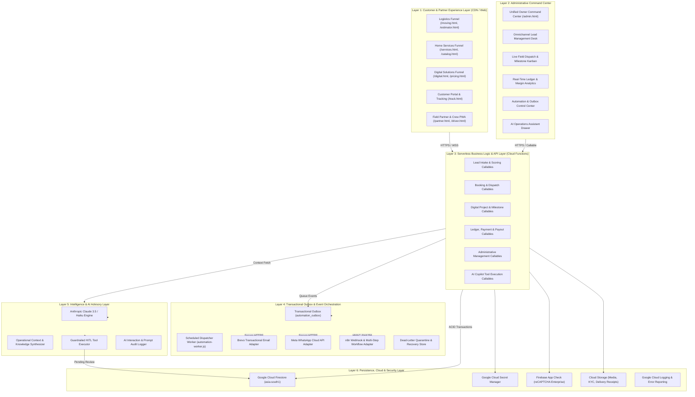
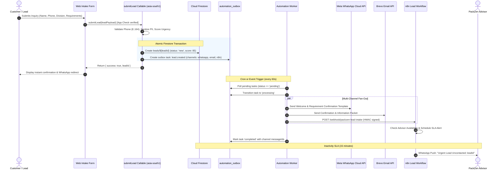
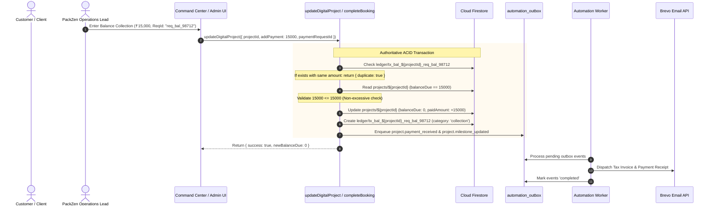

# PACKZEN 3.0 — PHASE 4 MASTER PLATFORM ARCHITECTURE
## Unified Automation-First Multi-Division Business Operating System

**Document Version:** 4.0.0  
**Status:** Approved Master Architecture Specification  
**Target Environment:** `packzen-e7539` (Google Cloud / Firebase `asia-south1`)  
**Production Domain:** `https://packzenblr.in`  
**Operating Division Scope:** PackZen Logistics, PackZen Home Services, PackZen Digital  
**Baseline Commit:** `0c3f91264c123689626c59bce2cf4c3ae63ea25a` (Branch: `firebase-hosting-migration`)

---

## 1. Executive Summary & Vision

PackZen 3.0 transforms three fragmented business operational units—**PackZen Logistics** (Packers & Movers, intercity and intra-Bengaluru relocation), **PackZen Home Services** (on-demand appliance repair, AC maintenance, deep cleaning), and **PackZen Digital** (high-conversion web design, SEO, local business growth engineering)—into a single, unified, automation-first, AI-assisted business operating platform.

Historically, each operating vertical evolved with bespoke pipelines, distinct customer schemas, and siloed administrative views. Phase 4 establishes an integrated enterprise core that:
1. **Unifies Customer & Operational Records:** Consolidates customer profiles, inbound leads, service orders, digital deliverables, partner crews, and financial transactions without disruptive database migrations.
2. **Guarantees Transactional Automation:** Uses an atomic transactional outbox pattern to orchestrate multi-channel communications (Brevo transactional email, Meta WhatsApp Cloud API, n8n webhook pipelines) with zero message loss and zero phantom executions.
3. **Embeds Server-Side Financial Truth:** Tracks all money movements through an authoritative categorized ledger enforcing double-entry integrity, deterministic payment idempotency, balance overpayment prevention, and real-time division P&L reporting.
4. **Delivers an AI Operations Copilot:** Augments operational staff with an Anthropic Claude / Gemini powered assistant bound by strict Human-in-the-Loop (HITL) execution controls, eliminating unauthorized autonomous database mutations.
5. **Maintains Zero-Downtime Production Continuity:** Preserves 100% backward compatibility with existing production APIs, static landing pages, and client flows across all 57 verified regression test suites.

```
+--------------------------------------------------------------------------------------------------+
|                                    PACKZEN 3.0 UNIFIED PLATFORM                                  |
+--------------------------------+--------------------------------+--------------------------------+
|      PACKZEN LOGISTICS         |      PACKZEN HOME SERVICES     |       PACKZEN DIGITAL          |
|  - Intra-city Relocation       |  - AC Service & Installation   |  - Custom Web Engineering      |
|  - Intercity Corridor Moving   |  - Major Appliance Repair      |  - Local SEO & Performance     |
|  - Vehicle & Luggage Transport |  - Deep Cleaning & Sanitization|  - WhatsApp Business Funnels   |
+--------------------------------+--------------------------------+--------------------------------+
|                                UNIFIED ARCHITECTURAL FOUNDATION                                  |
|  - Shared Customer & Lead Identity (`users`, `leads`)                                            |
|  - Unified Booking & Lifecycle Engine (`bookings`, `projects`)                                   |
|  - Categorized Double-Entry Financial Ledger (`ledger`)                                          |
|  - Centralized Transactional Outbox & Automation Dispatcher (`automation_outbox`)                |
|  - Grounded AI Assistant with Guardrailed Tool Execution (`assistant-ai.js`)                    |
|  - Enterprise Multi-Tenant RBAC & App Check Enforcement (`firestore.rules`, Firebase Auth)       |
+--------------------------------------------------------------------------------------------------+
```

---

## 2. Core Architectural Tenets & Constraints

1. **Zero-Trust Security & Explicit Privilege Separation:**
   - Client applications never write directly to sensitive collections (`ledger`, `automation_outbox`, `automation_logs`, `projects`).
   - Every administrative action requires verified Google Firebase Auth tokens containing verified owner or administrative custom claims (`context.auth.token.role === 'owner' || 'admin'`).
   - App Check is enforced at the Cloud Function boundary to prevent unauthorized automated abuse.

2. **Transactional Outbox for Event Consistency:**
   - Any state change requiring external side effects (email, WhatsApp, webhook notifications) must write an outbox record inside the *same atomic Firestore transaction* as the entity update.
   - Outbox dispatchers execute with at-least-once delivery guarantees, bounded exponential backoff, and dead-letter isolation.

3. **Deterministic Financial Integrity:**
   - The platform ledger is strictly append-only. Existing ledger entries are immutable.
   - All balance collections mandate a deterministic `paymentRequestId` allowing safe idempotency and preventing double-billing on network retries.
   - Balance overpayment is rejected at the database transaction layer.

4. **Strict AI Advisory Isolation:**
   - AI models act strictly as advisors, analysts, and draft generators.
   - Autonomous database writes, financial transactions, partner payouts, and customer-facing commitments by the AI are architecturally forbidden.
   - All mutations generated by AI tools require explicit human approval via the Admin Command Center.

5. **Non-Destructive Evolution:**
   - Existing production endpoints (`createBooking`, `calculateEstimate`, `submitLead`, `createDigitalProject`, `updateDigitalProject`) remain fully functional.
   - New capabilities extend existing schemas with optional attributes, preserving full backward compatibility.

---

## 3. Six-Layer Logical Architecture



### Detailed Layer Descriptions

#### Layer 1: Customer & Partner Experience Layer
- **Public Client Surfaces:** Highly responsive, zero-framework vanilla JavaScript web applications hosted on Firebase CDN edge nodes.
- **Conversion-Optimized Landing Pages:** Deeply indexed, programmatic SEO pages covering Bengaluru localities (Whitefield, Koramangala, Indiranagar, HSR Layout, etc.) with structured Schema.org JSON-LD data.
- **Field Partner Mobile Webapp:** Lightweight, low-bandwidth PWA interface for moving crews and service technicians featuring geo-fenced job claim, navigation integration, and dual-PIN OTP service completion.

#### Layer 2: Administrative Command Center
- **Unified Backoffice (`/admin.html`):** Single-pane-of-glass administrative workstation built as a modular dashboard.
- **Division Switcher:** Instant filtering across All Divisions, Logistics, Home Services, and Digital Solutions.
- **Real-Time Stream:** Live Firestore listener integration for instantaneous job updates, lead alerts, and delivery failures.
- **AI Copilot Drawer:** Persistent, interactive conversational panel enabling owners to run ad-hoc business queries, draft proposals, and trigger authorized operations.

#### Layer 3: Serverless Business Logic & API Layer
- **Node.js 22 Cloud Functions:** Colocated in `asia-south1` (Mumbai) to ensure single-digit millisecond latency to Indian end-users and databases.
- **Callable Architecture:** Strictly authenticated Firebase onCall handlers wrapping business operations in authoritative validation, schema sanity checks, and transactional write patterns.

#### Layer 4: Transactional Outbox & Event Orchestration
- **Guaranteed At-Least-Once Delivery:** Decouples customer response time from external communication latency.
- **Multi-Adapter Support:** Standardized interface for email (Brevo), WhatsApp (Meta Cloud API), and custom webhooks (n8n).
- **Control Center Management:** Integrated monitoring, replay, retry cooldown, and manual dead-letter resolution.

#### Layer 5: Intelligence & AI Advisory Layer
- **Context-Aware Grounding:** Operational prompts dynamically injected with live business KPIs, service catalog prices, vehicle specs, and customer history.
- **Strictly Scoped Tool Definitions:** Clear JSON schemas defining tool inputs and outputs. Mutating tools return proposed actions requiring human confirmation.

#### Layer 6: Persistence, Cloud & Security Layer
- **Cloud Firestore:** Primary ACID transactional document store partitioned into logical sub-domains with compound indexing.
- **Cloud Secret Manager:** Dedicated encryption at rest and in transit for API keys, Webhook secrets, and database credentials.
- **Firebase App Check:** Cryptographic attestation of client identity via reCAPTCHA Enterprise.

---

## 4. Cross-Division Functional Boundaries

```
+---------------------------------------------------------------------------------------------------------+
|                                    CROSS-DIVISION FUNCTIONAL MATRIX                                     |
+----------------------+--------------------------+---------------------------+---------------------------+
| CAPABILITY           | PACKZEN LOGISTICS        | PACKZEN HOME SERVICES     | PACKZEN DIGITAL           |
+----------------------+--------------------------+---------------------------+---------------------------+
| Primary Entity       | `bookings` (type: move)  | `bookings` (type: service)| `projects`                |
| Lead Workflow        | Origin/Dest, BHK, Date   | Appliance, Issue, Slot    | Scope, Tech Stack, Budget |
| Pricing Engine       | Distance, Volume, Floors | Flat / Tiered Service Rate| Custom / Milestone Quotes |
| Fulfillment Unit     | Vehicle + Crew Assigned  | Assigned Technician       | Assigned Engineering Lead |
| Verification Model   | Pickup & Delivery OTP    | Diagnostic & Finish OTP   | Milestone Client Sign-off |
| Revenue Model        | Advance (20%) + Balance  | Booking Fee + Job Balance | Advance (50%) + Milestones|
| Partner Payout       | Base + Km + Floor Bonus  | Fixed Fee + Spare Parts   | Internal / Contractor Fee |
+----------------------+--------------------------+---------------------------+---------------------------+
```

---

## 5. End-to-End Component Interaction Sequences

### 5.1 Inbound Lead Intake & Automated Multi-Channel Triaging



### 5.2 Deterministic Balance Settlement & Milestone Completion



---

## 6. System Topology & Physical Architecture

PackZen 3.0 runs in a serverless, managed topology within Google Cloud Platform and Firebase:

```
+------------------------------------------------------------------------------------+
|                       GOOGLE CLOUD REGION: asia-south1 (MUMBAI)                    |
|                                                                                    |
|  +---------------------------+   +----------------------------------------------+  |
|  |     FIREBASE HOSTING      |   |            CLOUD FUNCTIONS (v2)              |  |
|  |   - Global CDN Edge       |   |  - Node.js 22 Runtime                        |  |
|  |   - Static HTML / JS / CSS|   |  - Regional VPC Connector                    |  |
|  |   - SSL / Custom Domain   |   |  - 256MB - 1GB Autoscaled Instances          |  |
|  +-------------+-------------+   +----------------------+-----------------------+  |
|                |                                        |                          |
|                | App Check / HTTPS                      | Private Service Access   |
|                v                                        v                          |
|  +-------------------------------------------------------------------------------+ |
|  |                               CLOUD FIRESTORE                                 | |
|  |   - Multi-Region / Regional asia-south1 Instance                              | |
|  |   - Document Collections: users, leads, bookings, projects, ledger            | |
|  |   - Transactional Subcollections: automation_outbox, automation_logs          | |
|  |   - Security Rules Engine & Compound Index Catalog                            | |
|  +-------------------------------------------------------------------------------+ |
|        |                                                |                          |
|        v                                                v                          |
|  +---------------------------+   +----------------------------------------------+  |
|  |    CLOUD SECRET MANAGER   |   |                CLOUD STORAGE                 |  |
|  |  - BREVO_API_KEY          |   |  - KYC Verification Documents (Restricted)   |  |
|  |  - WHATSAPP_ACCESS_TOKEN  |   |  - Proof-of-Delivery / Sign-off Photos       |  |
|  |  - N8N_WEBHOOK_SECRET     |   |  - Invoices & PDF Reports                    |  |
|  |  - ANTHROPIC_API_KEY      |   |                                              |  |
|  +---------------------------+   +----------------------------------------------+  |
+------------------------------------------------------------------------------------+
                                 | Outbound Webhooks & REST
                                 v
+------------------------------------------------------------------------------------+
|                         EXTERNAL PRODUCTION GATEWAYS                               |
|  - Meta WhatsApp Cloud API (Graph v21.0)                                           |
|  - Brevo Transactional Email Engine (REST v3)                                      |
|  - n8n Automation Engine (Railway hosted instance with TLS)                        |
|  - Anthropic Claude / Google Gemini LLM API Endpoints                              |
+------------------------------------------------------------------------------------+
```

---

## 7. Operational Resilience & Fault Tolerance Strategy

1. **Idempotent Outbox Processing:**
   - Every outbox message possesses a deterministic or unique UUID `eventId`.
   - Receiver endpoints (n8n, webhook listeners) store seen `eventId`s in Redis or persistent storage with a 72-hour TTL.
   - If a network failure occurs after sending an event but before marking it completed in Firestore, a retry transmits the identical `eventId`, preventing double operations.

2. **Circuit Breaking on Upstream Failure:**
   - When external APIs (Brevo, Meta WhatsApp) experience consecutive HTTP 5xx or rate limit responses (HTTP 429), the automation worker trips a temporary circuit breaker for that channel.
   - Events targeting the degraded channel enter an `adapter_pending` or temporary backoff state without exhausting their retry counter.
   - Normal operations automatically resume once the health check passes.

3. **Graceful Degradation:**
   - If the AI Copilot API is unreachable or rate limited, the administrative Command Center gracefully displays a cached state and falls back to manual control modes without blocking business operations.
   - If WhatsApp API tokens expire, critical customer notifications automatically fall back to Brevo transactional email.

---

## 8. Architectural Sign-Off Criteria

The Master Architecture is deemed active and authoritative under the following conditions:
- [x] All 3 operational divisions (Logistics, Home Services, Digital) are represented in unified data structures.
- [x] Transactional consistency is maintained across all financial mutations and outbox emissions.
- [x] AI capabilities are isolated behind strict Human-in-the-Loop authorization gates.
- [x] All existing 57 regression test suites pass without regression.
- [x] Zero destructive schema migrations are required on the live Firestore database.
