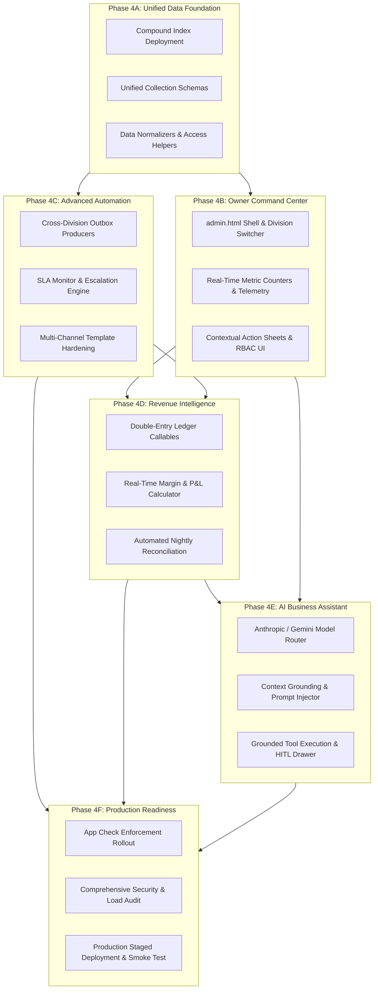

# PACKZEN 3.0 — PHASE 4 IMPLEMENTATION ROADMAP
## Work Breakdown Structure, Phased Execution Strategy & Milestones (4A through 4F)

**Document Version:** 4.0.0  
**Status:** Approved Master Implementation Roadmap  
**Target Environment:** `packzen-e7539` (Firebase / Cloud Functions `asia-south1`)  
**Timeline:** Phased Progressive Rollout

---

## 1. Master Phasing Architecture & Critical Path

The PackZen 3.0 Phase 4 implementation is decomposed into 6 sequential subphases designed to ensure continuous operational uptime, zero regression of existing features, and rigorous security verification at each stage:

---

## 2. Work Breakdown Structure (Subphases 4A–4F)

### 2.1 Subphase 4A: Unified Data Foundation
**Objective:** Establish unified multi-division schemas, deploy required compound indexes, and implement non-destructive entity normalization helpers.

- **Work Packages:**
  - `WBS-4A.1`: Configure `firestore.indexes.json` with multi-division compound indexes (leads, bookings, projects, ledger).
  - `WBS-4A.2`: Author unified backend model accessors in `functions/unified-models.js` providing lazy backward-compatible normalization for legacy records.
  - `WBS-4A.3`: Harden `firestore.rules` for unified collection access control and client-side write prevention.
- **Deliverables:**
  - `functions/unified-models.js`
  - `firestore.indexes.json`
  - Unit test suite: `functions/test/phase4a-data-foundation.test.js`
- **Definition of Done (DoD):**
  - All existing 57 regression suites pass without modification.
  - Compound indexes successfully deployed to Firestore.
  - 100% test coverage on entity normalization helpers.

---

### 2.2 Subphase 4B: Owner Command Center
**Objective:** Deliver the unified administrative workspace, global division switcher, real-time KPI counters, and modular operational views inside `admin.html`.

- **Work Packages:**
  - `WBS-4B.1`: Refactor `public/admin.html` with responsive Grid/Flexbox navigation, persistent header, and division switcher tabs.
  - `WBS-4B.2`: Implement `public/js/admin-state.js` and `public/js/admin-telemetry.js` managing Firestore snapshot listeners with automatic tear-down.
  - `WBS-4B.3`: Build unified Lead, Dispatch, and Milestone management panels with contextual inline action dialogs.
- **Deliverables:**
  - `public/admin.html` updates
  - `public/js/admin-state.js`, `public/js/admin-telemetry.js`
  - Visual verification artifacts (desktop and mobile viewports)
- **Definition of Done (DoD):**
  - Zero framework dependencies; instant page load (< 1.2s on 4G).
  - Real-time counters update automatically on Firestore database changes.
  - RBAC UI correctly hides sensitive controls for non-owner roles.

---

### 2.3 Subphase 4C: Advanced Cross-Division Automation
**Objective:** Extend the transactional outbox architecture with SLA escalation monitors, automated follow-up cascades, and enhanced multi-channel templates.

- **Work Packages:**
  - `WBS-4C.1`: Author `functions/sla-monitor.js` scheduled Cloud Function checking lead response times and milestone deadlines.
  - `WBS-4C.2`: Author cross-division transactional outbox producers (`emitLeadSlaBreachTx`, `emitMilestoneOverdueTx`).
  - `WBS-4C.3`: Integrate verified Brevo HTML email templates and Meta WhatsApp interactive message schemas.
- **Deliverables:**
  - `functions/sla-monitor.js`
  - Updates to `functions/automation-producers.js` and `functions/automation-worker.js`
  - Dedicated test suite: `functions/test/phase4c-automation.test.js`
- **Definition of Done (DoD):**
  - SLA breach events automatically created in outbox upon inactivity threshold.
  - Zero lost events or unhandled exceptions under simulated network failure.

---

### 2.4 Subphase 4D: Revenue & Financial Intelligence
**Objective:** Implement authoritative categorized double-entry ledger callables, real-time margin computation, and automated nightly reconciliation.

- **Work Packages:**
  - `WBS-4D.1`: Author `functions/finance-ledger.js` implementing `recordLedgerTransaction`, `getFinancialOverview`, and `settleBalancePayment`.
  - `WBS-4D.2`: Enforce deterministic `paymentRequestId` idempotency and balance overpayment prevention across all collections.
  - `WBS-4D.3`: Author `functions/finance-reconciliation.js` scheduled nightly auditor asserting zero variance between ledger sum and entity paid amounts.
- **Deliverables:**
  - `functions/finance-ledger.js`, `functions/finance-reconciliation.js`
  - Test suite: `functions/test/phase4d-finance.test.js`
- **Definition of Done (DoD):**
  - Rejection of invalid, negative, or excessive payment amounts verified.
  - Idempotency verified: re-sending identical request IDs produces zero duplicate ledger records.
  - Discrepancy detector correctly identifies synthetic balance variances.

---

### 2.5 Subphase 4E: AI Business Assistant (Copilot)
**Objective:** Deploy the internal operations copilot featuring Anthropic Claude Haiku / Gemini model routing, prompt grounding, tool schemas, and Human-in-the-Loop action sheets.

- **Work Packages:**
  - `WBS-4E.1`: Author `functions/assistant-copilot.js` Cloud Function with model routing, context grounding, and tool dispatch.
  - `WBS-4E.2`: Implement 6 strictly typed tools (`query_financials`, `inspect_leads`, `get_operational_health`, `propose_lead_quote`, `propose_booking_reschedule`, `propose_milestone_update`).
  - `WBS-4E.3`: Build UI drawer in `public/js/admin-ai-copilot.js` rendering markdown responses and interactive HITL action approval cards.
- **Deliverables:**
  - `functions/assistant-copilot.js`
  - `public/js/admin-ai-copilot.js`
  - Test suite: `functions/test/phase4e-copilot.test.js`
- **Definition of Done (DoD):**
  - Autonomous database mutations strictly blocked.
  - Proposed actions render interactive cards requiring human click authorization.
  - PII and credentials automatically masked before reaching LLM endpoints.

---

### 2.6 Subphase 4F: Production Readiness & Release
**Objective:** Execute security audits, App Check activation, performance benchmarking, end-to-end smoke testing, and staged zero-downtime deployment.

- **Work Packages:**
  - `WBS-4F.1`: Conduct independent security and vulnerability audit across rules, callables, and endpoints.
  - `WBS-4F.2`: Transition Firebase App Check to enforcement mode with verified token monitoring.
  - `WBS-4F.3`: Execute end-to-end regression validation across all test suites (target: >65 suites).
  - `WBS-4F.4`: Execute staged zero-downtime production deployment to `packzen-e7539`.
- **Deliverables:**
  - Comprehensive Final Security Audit Report
  - Production Deployment & Verification Sign-Off
- **Definition of Done (DoD):**
  - 100% pass rate on all test suites.
  - Production verification confirmed on `https://packzenblr.in`.
  - Zero downtime observed during release rollout.

---

## 3. Resource Allocation & Critical Path Milestones

| Subphase | Focus Area | Complexity | Dependencies | Gate Review Requirement |
|---|---|---|---|---|
| **Phase 4A** | Unified Data Foundation | Medium | Baseline Commit | Security & Index Verification |
| **Phase 4B** | Owner Command Center | High | Phase 4A | UI/UX & Telemetry Audit |
| **Phase 4C** | Advanced Automation | High | Phase 4A | Outbox & SLA Verification |
| **Phase 4D** | Revenue Intelligence | Critical | Phase 4A, 4B | Financial Integrity Audit |
| **Phase 4E** | AI Business Assistant | High | Phase 4B, 4D | HITL Safety & Guardrail Audit |
| **Phase 4F** | Production Readiness | Critical | Phase 4A–4E | Final Master Security Gate |
