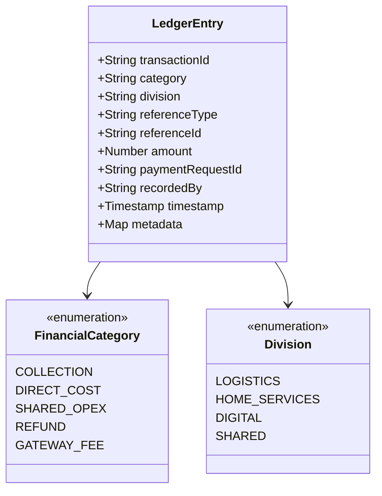
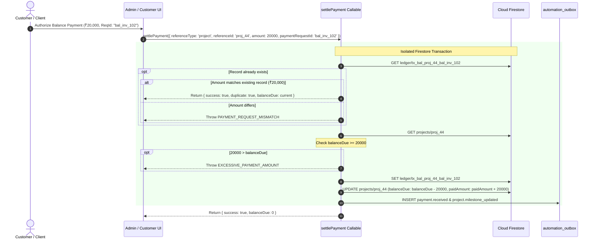

# PACKZEN 3.0 — REVENUE & FINANCIAL INTELLIGENCE SPECIFICATION
## Categorized Double-Entry Ledger, Margin Analytics & Automated Reconciliation

**Document Version:** 4.0.0  
**Status:** Approved Master Financial Specification  
**Target Environment:** `functions/digital-projects.js`, `functions/finance-*.js`, `public/admin-ecosystem.js`  
**Governing Standard:** PackZen Financial Integrity Architecture (Audited in Phase 3.1)

---

## 1. Financial Architecture Principles

1. **Strict Append-Only Immutability:**
   - Financial ledger entries (`ledger`) are write-once records. No financial document may be modified or deleted post-creation.
   - Adjustments, write-offs, or refunds must be entered as new countervailing ledger transactions referencing the original transaction ID.

2. **Server-Authoritative Double-Entry Accounting:**
   - Client applications cannot directly calculate balances, record payments, or adjust fees.
   - Every financial state change executes inside an isolated Firestore ACID transaction verifying current balances against authoritative ledger history.

3. **Deterministic Idempotency on Balance Collections:**
   - Balance collections require a client-provided `paymentRequestId`.
   - Repeated requests with the identical request ID return duplicate success without creating additional ledger entries or deducting balances multiple times.
   - Re-attempting an identical request ID with a different monetary amount is immediately rejected with `PAYMENT_REQUEST_MISMATCH`.

4. **Zero-Tolerance Anti-Overpayment:**
   - Under no circumstances can a payment be collected that exceeds the entity's current `balanceDue`.
   - Any transaction attempting to record an excessive amount throws `EXCESSIVE_PAYMENT_AMOUNT` and aborts.

---

## 2. Categorized Ledger Architecture

Every financial event across all three divisions is normalized into the `ledger` collection:



### Ledger Categories Defined:
- `collection`: Inflows from customers (advance deposits, milestone collections, balance payments). Increases Gross Revenue.
- `direct_cost`: Outflows directly attributable to service fulfillment (driver trip payouts, technician labor fees, third-party software licenses, packing materials).
- `shared_opex`: General operational expenses not tied to a single job (office rent, cloud infrastructure hosting, Google Workspace, shared staff salaries).
- `refund`: Involuntary or voluntary customer capital returns. Reverses past collection.
- `gateway_fee`: Transaction processing charges deducted by payment processors (Razorpay / Stripe 2% + GST).

---

## 3. Automated Margin & P&L Calculation Engine

The Revenue Intelligence engine provides real-time P&L reporting partitioned by division and aggregated across the enterprise:

```
+----------------------------------------------------------------------------------------------------+
|                                    PACKZEN 3.0 FINANCIAL FORMULA                                   |
+----------------------------------------------------------------------------------------------------+
|                                                                                                    |
|  1. GROSS REVENUE               = SUM(category == 'collection') - SUM(category == 'refund')        |
|                                                                                                    |
|  2. DIRECT COSTS                = SUM(category == 'direct_cost') + SUM(category == 'gateway_fee')   |
|                                                                                                    |
|  3. CONTRIBUTION MARGIN (CM)    = GROSS REVENUE - DIRECT COSTS                                     |
|                                                                                                    |
|  4. CONTRIBUTION MARGIN %       = (CONTRIBUTION MARGIN / GROSS REVENUE) * 100                      |
|                                                                                                    |
|  5. ALLOCATED OPEX              = Direct Opex + (Shared Opex * Division Revenue Weight)            |
|                                                                                                    |
|  6. NET OPERATING PROFIT (EBIT) = CONTRIBUTION MARGIN - ALLOCATED OPEX                             |
|                                                                                                    |
+----------------------------------------------------------------------------------------------------+
```

### Real-Time Financial Metric Dashboard:

```
+----------------------------------------------------------------------------------------------------+
| FINANCIAL INTELLIGENCE CONSOLE — NOVEMBER 2026                                                     |
+--------------------------+--------------------+---------------------+------------------------------+
| DIVISION                 | GROSS REVENUE      | DIRECT COSTS        | CONTRIBUTION MARGIN (%)      |
+--------------------------+--------------------+---------------------+------------------------------+
| PackZen Logistics        | ₹ 12,45,000        | ₹ 8,10,000 (Fuel/Cr)| ₹ 4,35,000 (34.9%)           |
| PackZen Home Services    | ₹  3,80,000        | ₹ 1,90,000 (Techs)  | ₹ 1,90,000 (50.0%)           |
| PackZen Digital          | ₹  7,50,000        | ₹ 1,20,000 (Infra)  | ₹ 6,30,000 (84.0%)           |
+--------------------------+--------------------+---------------------+------------------------------+
| ENTERPRISE TOTAL         | ₹ 23,75,000        | ₹ 11,20,000         | ₹ 12,55,000 (52.8%)          |
| Shared Operational Opex  |                    |                     | ₹  3,20,000 (Rent/Cloud)     |
| NET OPERATING PROFIT     |                    |                     | ₹  9,35,000 (39.4%)          |
+--------------------------+--------------------+---------------------+------------------------------+
```

---

## 4. Transactional Settlement & Payment Flow



---

## 5. Automated Financial Reconciliation & Anomaly Detection

A daily scheduled Cloud Function (`financeReconciliationWorker`) executes at 02:00 IST to audit database ledger parity:

### Reconciliation Assertions:
1. **Entity Balance Integrity Check:**
   - For every active `bookings` and `projects` document:
     `totalAmount - paidAmount == balanceDue`
   - Any mathematical variance > ₹0.01 flags an immediate critical audit incident.
2. **Ledger Sum vs Entity Paid Parity:**
   - Sum of all `collection` ledger entries minus `refund` entries for `referenceId` must exactly equal `entity.paidAmount`.
3. **Gateway Settlement Audit:**
   - Matches incoming Razorpay payment IDs against ledger transaction records. Unmatched gateway credits generate a `discrepancy_unlinked_payment` ticket.
4. **Partner Payout Guardrail:**
   - Ensures driver and technician wallet balances never turn negative.
   - Payout releases are blocked if KYC verification has expired or has been revoked.

---

## 6. Financial Audit Sign-Off Standards

Financial operations for Phase 4 are governed by strict verification checkpoints:
- **Zero Double-Billing Incidents:** Form retries and network disconnects cannot produce duplicate collections.
- **Zero Negative Balance Tolerances:** Balance due can never drop below zero.
- **100% Traceability:** Every ledger record contains the initiating `uid` or `system` process name, payment request identifier, and exact millisecond server timestamp.
