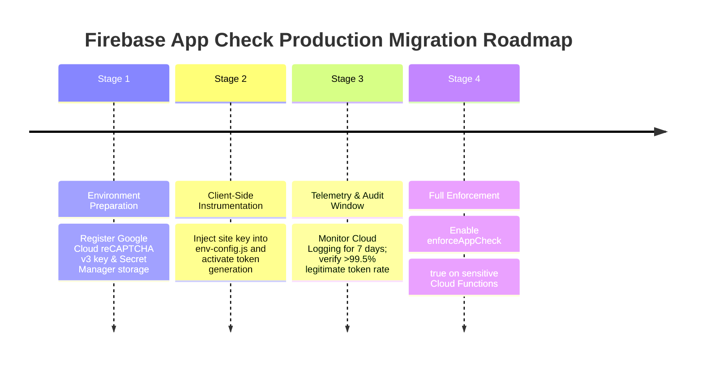

# PACKZEN 3.0 — PRODUCTION SECURITY & RELEASE DEPLOYMENT PLAN
## Defense-in-Depth, App Check Migration, Secrets Hygiene & Zero-Downtime Releases

**Document Version:** 4.0.0  
**Status:** Approved Master Security & Release Specification  
**Target Environment:** `packzen-e7539` (Google Cloud / Firebase `asia-south1`)  
**Production Domain:** `https://packzenblr.in`

---

## 1. Security Architecture & Threat Model

PackZen 3.0 processes customer relocations, technician home entries, digital project IP, and financial transactions. Security is implemented via a **Defense-in-Depth** model spanning 5 distinct defensive rings:

```
+------------------------------------------------------------------------------------+
|                         PACKZEN 3.0 DEFENSIVE RINGS                                |
+------------------------------------------------------------------------------------+
| [RING 1: EDGE & NETWORK]      Firebase CDN SSL, CORS Policy, Rate Limiting         |
| [RING 2: CLIENT IDENTITY]     Firebase App Check (reCAPTCHA Enterprise v3)         |
| [RING 3: USER AUTHENTICATION] Firebase Auth JWT with Verified Custom Claims        |
| [RING 4: ACCESS CONTROL]      Firestore Security Rules (Strict Write Denials)      |
| [RING 5: BUSINESS LOGIC]      Serverless Functions, Input Allowlisting, Outbox ACID|
+------------------------------------------------------------------------------------+
```

---

## 2. Role-Based Access Control (RBAC) Matrix

Firebase Auth Custom Claims represent the single source of truth for identity and authority:

```json
{
  "role": "owner", // "owner" | "admin" | "operations" | "finance" | "advisor" | "customer" | "partner"
  "divisions": ["all"], // ["all"] | ["logistics"] | ["home_services"] | ["digital"]
  "verifiedStaff": true
}
```

### Server-Side Authority Matrix:

| Capability / API Endpoint | Owner | Admin | Operations | Finance | Advisor | Customer | Partner |
|---|:---:|:---:|:---:|:---:|:---:|:---:|:---:|
| `submitLead` | Public | Public | Public | Public | Public | Public | Public |
| `createBooking` | Yes | Yes | Yes | No | Yes | Self | No |
| `completeBooking` (with OTP) | Yes | Yes | Yes | No | No | No | Assigned |
| `createDigitalProject` | Yes | Yes | No | No | No | No | No |
| `updateDigitalProject` | Yes | Yes | Yes | Yes | No | No | No |
| `settlePayment` (Ledger write) | Yes | Yes | No | Yes | No | No | No |
| `retryAutomationEvent` | Yes | No | No | No | No | No | No |
| Direct Firestore writes to `ledger` | **DENIED** | **DENIED** | **DENIED** | **DENIED** | **DENIED** | **DENIED** | **DENIED** |
| Direct Firestore writes to `outbox` | **DENIED** | **DENIED** | **DENIED** | **DENIED** | **DENIED** | **DENIED** | **DENIED** |

---

## 3. Firestore Security Rules Hardening Specification

The following security rules specification enforces strict client-write denials across sensitive operational collections:

```javascript
rules_version = '2';
service cloud.firestore {
  match /databases/{database}/documents {

    function isAuthenticated() {
      return request.auth != null;
    }

    function isOwner() {
      return isAuthenticated() && request.auth.token.role == 'owner';
    }

    function isAdmin() {
      return isAuthenticated() && (request.auth.token.role in ['owner', 'admin']);
    }

    function isStaff() {
      return isAuthenticated() && request.auth.token.verifiedStaff == true;
    }

    // 1. Users: Users can read/write their own profile; Staff can read
    match /users/{userId} {
      allow read: if isStaff() || (isAuthenticated() && request.auth.uid == userId);
      allow write: if isAuthenticated() && request.auth.uid == userId && !request.resource.data.diff(resource.data).affectedKeys().hasAny(['role', 'verifiedStaff']);
    }

    // 2. Leads: Public submission allowed; Staff reads and updates
    match /leads/{leadId} {
      allow create: if true; // Public lead intake
      allow read, update: if isStaff();
      allow delete: if isOwner();
    }

    // 3. Bookings: Customers view own bookings; Partners view assigned; Staff full access
    match /bookings/{bookingId} {
      allow read: if isStaff() || (isAuthenticated() && (resource.data.customerId == request.auth.uid || resource.data.partnerId == request.auth.uid));
      allow write: if false; // All mutations strictly routed through Cloud Functions
    }

    // 4. Projects: Clients view own project; Staff view; Client writes strictly denied
    match /projects/{projectId} {
      allow read: if isStaff() || (isAuthenticated() && resource.data.clientEmail == request.auth.token.email);
      allow write: if false; // Cloud Functions only (Phase 3 requirement)
    }

    // 5. Ledger: Append-only via Cloud Functions. All direct client writes forbidden
    match /ledger/{txId} {
      allow read: if isAdmin() || (isAuthenticated() && request.auth.token.role == 'finance');
      allow write: if false; // Cloud Functions transaction only
    }

    // 6. Automation Outbox & Logs: Completely inaccessible to clients
    match /automation_outbox/{eventId} {
      allow read: if isOwner();
      allow write: if false; // Backend workers only
    }
    match /automation_logs/{logId} {
      allow read: if isOwner();
      allow write: if false;
    }

    // 7. Partners: Partners view own profile; Staff manage
    match /partners/{partnerId} {
      allow read: if isStaff() || (isAuthenticated() && request.auth.uid == partnerId);
      allow write: if false; // Admin callables only
    }
  }
}
```

---

## 4. App Check Migration Strategy (Monitoring to Enforcement)

Currently, Firebase App Check operates in **Monitoring Mode** (`APPCHECK_RECAPTCHA_V3_SITE_KEY: ""`). To achieve complete anti-abuse enforcement without locking out legitimate customers, the rollout follows a 4-stage progression:



### Verification Criteria for Stage 4 Activation:
- Zero unverified requests originating from legitimate mobile browsers in Bengaluru.
- Documented bypass allowlist for internal automated integration test runners.
- Immediate rollback toggle available via Cloud Secret Manager (`APPCHECK_ENFORCE=false`).

---

## 5. Secrets Hygiene & Key Rotation Framework

All production secrets reside exclusively in **Google Cloud Secret Manager**:
- `BREVO_API_KEY`
- `WHATSAPP_ACCESS_TOKEN`
- `WHATSAPP_APP_SECRET`
- `N8N_WEBHOOK_SECRET`
- `ANTHROPIC_API_KEY`
- `RAZORPAY_KEY_SECRET`

### Rotation Policy:
- **Bi-Annual Rotation:** Third-party API keys (Brevo, Anthropic, Razorpay) rotated every 180 days.
- **Short-Lived WhatsApp Tokens:** Meta System User tokens generated with 60-day expiry and auto-renewal alerts.
- **Immediate Emergency Invalidation:** In the event of code leak or compromised credentials, execution of the single-command secret rotation script:
  `gcloud secrets versions add <SECRET_NAME> --data-file=<NEW_SECRET>`

---

## 6. Zero-Downtime Deployment & Release Staging

```
+-----------------------------------------------------------------------------------+
|                        ZERO-DOWNTIME RELEASE PIPELINE                             |
+-----------------------------------------------------------------------------------+
|  STEP 1: LOCAL RUNTIME REGRESSION                                                 |
|          Execute npm test (All 57 regression test suites must pass 100%)          |
|                                                                                   |
|  STEP 2: FIRESTORE RULES AUDIT                                                    |
|          Deploy rules to staging emulator; verify write blocks on ledger & outbox |
|                                                                                   |
|  STEP 3: CLOUD FUNCTIONS CANARY ROLLOUT                                           |
|          Deploy backend functions with 10% traffic weighting                      |
|          Monitor Cloud Error Reporting for 30 minutes (0 unhandled exceptions)    |
|                                                                                   |
|  STEP 4: FULL BACKEND PROMOTION                                                   |
|          Promote functions to 100% traffic across asia-south1                     |
|                                                                                   |
|  STEP 5: STATIC ASSET CDN DEPLOYMENT                                              |
|          Deploy public/ to Firebase Hosting with cache-busting asset hashes       |
|                                                                                   |
|  STEP 6: POST-DEPLOYMENT SMOKE VERIFICATION                                       |
|          Execute automated smoke test (Lead -> Booking -> Outbox -> Ledger)       |
+-----------------------------------------------------------------------------------+
```

### Rollback Procedure:
- **Instant Frontend Rollback:** Firebase Hosting preserves release history:
  `firebase hosting:rollback` restores the previous CDN snapshot in < 5 seconds.
- **Functions Rollback:** If Cloud Functions exhibit regression, re-deploying the baseline commit (`0c3f91264c123689626c59bce2cf4c3ae63ea25a`) restores known good backend logic within 90 seconds.

---

## 7. Disaster Recovery & Error Budgets

- **Target Availability:** 99.95% uptime for customer-facing funnels (`https://packzenblr.in`).
- **RPO (Recovery Point Objective):** < 1 minute (Firestore Continuous Multi-Region replication).
- **RTO (Recovery Time Objective):** < 15 minutes to full operational restoration in case of regional cloud outage.
- **Automated Firestore Nightly Backups:** Managed Cloud Firestore export executed daily at 01:00 IST to isolated Cloud Storage bucket (`packzen-backups-asia-south1`).
