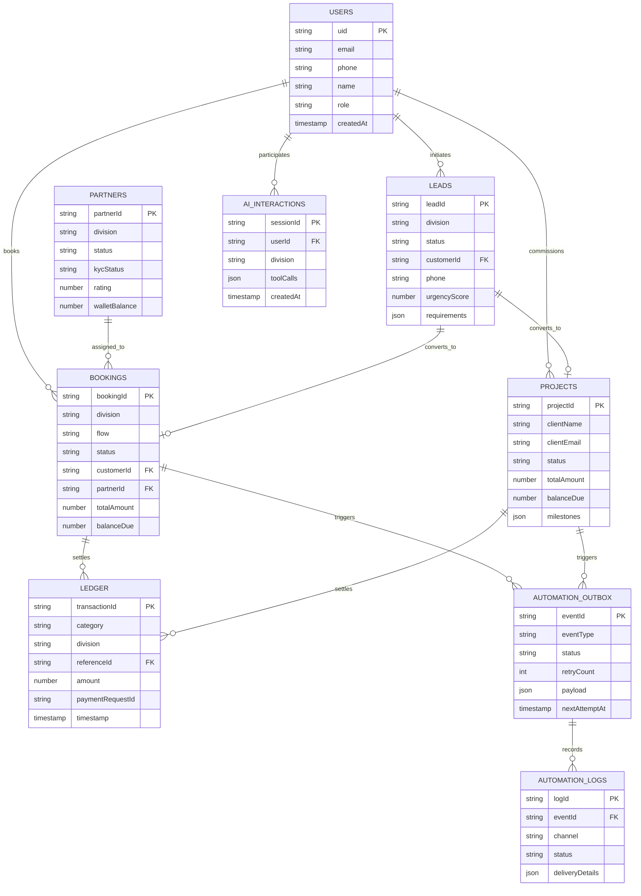

# PACKZEN 3.0 — UNIFIED DATA MODEL & SCHEMA SPECIFICATION
## Cross-Division Data Dictionary, Relational Integrity & Indexing Strategy

**Document Version:** 4.0.0  
**Status:** Approved Master Data Specification  
**Target Environment:** `packzen-e7539` (Cloud Firestore `asia-south1`)  
**Scope:** PackZen Logistics, PackZen Home Services, PackZen Digital Solutions

---

## 1. Architectural Data Principles

1. **Non-Destructive Schema Evolution:**
   - No fields in existing production documents will be renamed or deleted.
   - New fields across unified collections are additive and optional with sensible server-side defaults.
   - Legacy documents remain valid and parsable without requiring bulk migration scripts.

2. **Server-Side Authoritative Mutation:**
   - All financial balances (`balanceDue`, `paidAmount`, `totalAmount`) and lifecycle states (`status`, `stage`, `milestoneStatus`) must be mutated via serverless Cloud Functions executing Firestore transactions.
   - Client applications are granted strictly scoped read-only access governed by role claims.

3. **Denormalization with Authoritative Roots:**
   - Frequently displayed customer information (name, phone, locality) is denormalized onto `bookings`, `leads`, and `projects` to eliminate N+1 read overhead.
   - The authoritative master record resides in `users` and `ledger`.

---

## 2. Entity-Relationship Model



---

## 3. Comprehensive Collection Schemas

### 3.1 Collection: `users`
Represents all system actors: Customers, Field Drivers, Crew Members, Service Technicians, Advisors, and System Owners.

| Field Name | Type | Nullable | Validation Rules / Allowed Values | Description |
|---|---|---|---|---|
| `uid` | String | No | Firebase Auth UID (alphanumeric) | Document ID and primary authentication key |
| `phone` | String | No | E.164 format (e.g., `+919876543210`) | Authoritative mobile contact number |
| `email` | String | Yes | Valid email format | Customer or staff email address |
| `displayName` | String | No | 2-100 characters | Legal or preferred contact name |
| `role` | String | No | `customer`, `driver`, `technician`, `advisor`, `admin`, `owner` | System access role governing RBAC |
| `status` | String | No | `active`, `suspended`, `pending_verification` | Account lifecycle state |
| `divisionAffiliation`| Array[String] | Yes | `['logistics']`, `['home_services']`, `['digital']` | Applicable to staff and partners |
| `createdAt` | Timestamp | No | Server timestamp | Account creation instant |
| `updatedAt` | Timestamp | No | Server timestamp | Last profile modification instant |

### 3.2 Collection: `leads`
Omnichannel lead intake across all three business divisions.

| Field Name | Type | Nullable | Validation Rules / Allowed Values | Description |
|---|---|---|---|---|
| `leadId` | String | No | Unique ID (prefix: `lead_`) | Document ID |
| `division` | String | No | `logistics`, `home_services`, `digital` | Business vertical generating the inquiry |
| `source` | String | No | `website_form`, `whatsapp_inbound`, `phone_call`, `referral` | Acquisition channel |
| `customerName` | String | No | 2-100 characters | Name of the prospective customer |
| `phone` | String | No | E.164 format | Primary contact telephone |
| `email` | String | Yes | Valid email format | Contact email address |
| `stage` | String | No | `new`, `contacted`, `qualified`, `quotation_pending`, `quotation_sent`, `negotiation`, `converted`, `lost`, `closed` | 9-stage standard sales pipeline |
| `urgencyScore` | Number | No | Integer between 1 and 100 | AI/rule-calculated lead priority score |
| `assignedAdvisorId`| String | Yes | Valid `users` UID | Staff member responsible for lead |
| `requirements` | Map | No | Division-specific structured map | Dynamic requirements (see below) |
| `convertedEntityId`| String | Yes | `bookings/{id}` or `projects/{id}` | Target reference if converted |
| `createdAt` | Timestamp | No | Server timestamp | Time lead was ingested |
| `updatedAt` | Timestamp | No | Server timestamp | Time of last state change |

*Requirements Map by Division:*
- **Logistics:** `{ originLocality, destLocality, bhkSize: '1BHK'|'2BHK'|'3BHK'|'villa', moveDate, elevatorPickup: bool, elevatorDrop: bool }`
- **Home Services:** `{ serviceCategory: 'ac'|'refrigerator'|'washing_machine'|'cleaning', issueDescription, preferredSlot, applianceCount }`
- **Digital:** `{ projectScope: 'website'|'ecommerce'|'seo'|'custom', budgetRange, deadline, targetAudience }`

### 3.3 Collection: `bookings`
Operational service orders for Logistics (Packers & Movers) and Home Services.

| Field Name | Type | Nullable | Validation Rules / Allowed Values | Description |
|---|---|---|---|---|
| `bookingId` | String | No | Unique ID (e.g., `BK_90812`) | Document ID |
| `division` | String | No | `logistics`, `home_services` | Operating business vertical |
| `flow` | String | No | `move` (Logistics) or `service` (Home Services) | Operational workflow identifier |
| `status` | String | No | `draft`, `confirmed`, `assigned`, `in_transit`, `in_progress`, `completed`, `cancelled` | Live lifecycle state |
| `customerId` | String | No | Valid `users` UID | Primary customer reference |
| `customerName` | String | No | 2-100 characters | Denormalized customer name |
| `customerPhone`| String | No | E.164 format | Denormalized customer phone |
| `scheduledDate`| Timestamp | No | Future timestamp | Date and time of service execution |
| `partnerId` | String | Yes | Valid `partners` document ID | Assigned crew or technician |
| `totalAmount` | Number | No | Finite non-negative number | Total agreed service cost in INR |
| `advancePaid` | Number | No | Finite non-negative number | Upfront deposit paid in INR |
| `balanceDue` | Number | No | Finite non-negative number (`totalAmount - advancePaid`) | Outstanding balance to collect |
| `completionOtp`| String | Yes | 4 or 6 digit numeric string (hashed or server verified)| Service sign-off validation code |
| `createdAt` | Timestamp | No | Server timestamp | Creation timestamp |
| `updatedAt` | Timestamp | No | Server timestamp | Last update timestamp |

### 3.4 Collection: `projects`
Custom software, web engineering, and digital growth contracts for PackZen Digital.

| Field Name | Type | Nullable | Validation Rules / Allowed Values | Description |
|---|---|---|---|---|
| `projectId` | String | No | Unique ID (prefix: `proj_` or alphanumeric) | Document ID |
| `clientName` | String | No | 2-100 characters | Corporate or client individual name |
| `clientEmail` | String | No | Valid email address | Primary client billing email |
| `clientPhone` | String | Yes | E.164 format | Primary client phone |
| `tier` | String | No | `starter`, `business`, `custom`, `enterprise` | Package tier definition |
| `status` | String | No | `draft`, `active`, `in_progress`, `review`, `completed`, `cancelled` | High-level contract status |
| `totalAmount` | Number | No | Finite non-negative number | Total project contract price (INR) |
| `paidAmount` | Number | No | Finite non-negative number | Cumulative settled collections (INR) |
| `balanceDue` | Number | No | Finite non-negative number (`totalAmount - paidAmount`) | Remaining unbilled balance (INR) |
| `milestones` | Array[Map]| No | Validated milestone objects (see below) | Sequential project deliverables |
| `createdAt` | Timestamp | No | Server timestamp | Creation timestamp |
| `updatedAt` | Timestamp | No | Server timestamp | Last update timestamp |

*Milestone Object Schema:*
```json
{
  "id": "m1",
  "title": "Design Mockups & Client Approval",
  "status": "completed", // "pending" | "in_progress" | "review" | "completed"
  "amount": 10000,
  "dueDate": "2026-12-01T00:00:00.000Z",
  "completedAt": "2026-11-28T14:22:00.000Z"
}
```

### 3.5 Collection: `ledger`
Authoritative, append-only double-entry financial transaction store.

| Field Name | Type | Nullable | Validation Rules / Allowed Values | Description |
|---|---|---|---|---|
| `transactionId` | String | No | Deterministic ID (e.g., `tx_bal_${projectId}_${reqId}`) | Unique ledger transaction ID |
| `category` | String | No | `collection`, `direct_cost`, `shared_opex`, `refund`, `gateway_fee` | Accounting transaction category |
| `division` | String | No | `logistics`, `home_services`, `digital`, `shared` | Cost or revenue center |
| `referenceType` | String | No | `booking`, `project`, `general` | Source entity type |
| `referenceId` | String | No | Matching `bookingId` or `projectId` | Source entity ID |
| `amount` | Number | No | Finite positive number (INR) | Monetary value |
| `paymentRequestId`| String | Yes | Non-empty alphanumeric string (max 64 chars) | Idempotency key for balance payments |
| `recordedBy` | String | No | `system` or staff `uid` | User or process initiating transaction |
| `timestamp` | Timestamp | No | Server timestamp | Financial booking timestamp |

### 3.6 Collection: `partners`
Service partners, drivers, moving crews, and field technicians.

| Field Name | Type | Nullable | Validation Rules / Allowed Values | Description |
|---|---|---|---|---|
| `partnerId` | String | No | Unique ID (prefix: `ptnr_`) | Document ID |
| `division` | String | No | `logistics`, `home_services` | Operational vertical |
| `name` | String | No | 2-100 characters | Legal contractor or firm name |
| `phone` | String | No | E.164 format | Primary contact phone |
| `kycStatus` | String | No | `pending`, `submitted`, `verified`, `rejected` | Regulatory onboarding status |
| `status` | String | No | `active`, `inactive`, `suspended` | Field availability status |
| `rating` | Number | No | Decimal between 1.00 and 5.00 | Rolling average customer rating |
| `totalJobsCompleted`| Integer | No | Non-negative integer | Lifetime job counter |
| `walletBalance` | Number | No | Finite number (INR) | Pending platform balance payout |
| `createdAt` | Timestamp | No | Server timestamp | Registration timestamp |

### 3.7 Collection: `automation_outbox`
Transactional outbox store guaranteeing atomic side-effect execution.

| Field Name | Type | Nullable | Validation Rules / Allowed Values | Description |
|---|---|---|---|---|
| `eventId` | String | No | Deterministic or UUID v4 string | Unique event identifier |
| `eventType` | String | No | Standard event catalog name (e.g., `lead.created`, `project.created`) | Type of automation event |
| `status` | String | No | `pending`, `processing`, `completed`, `failed`, `adapter_pending`, `dead_letter` | State of outbound processing |
| `channels` | Array[String]| No | Subset of `['email', 'whatsapp', 'n8n']` | Target dispatch adapters |
| `retryCount` | Integer | No | Non-negative integer (0-5) | Number of attempted retries |
| `nextAttemptAt`| Timestamp | No | Timestamp | Earliest eligible execution time |
| `payload` | Map | No | Allowlisted, sanitized event data | Payload delivered to adapters |
| `lastError` | String | Yes | Error message string | Detailed error from last failed attempt |
| `createdAt` | Timestamp | No | Server timestamp | Event generation time |
| `processedAt`| Timestamp | Yes | Server timestamp | Completion timestamp |

### 3.8 Collection: `automation_logs`
Detailed audit log of individual adapter dispatch results.

| Field Name | Type | Nullable | Validation Rules / Allowed Values | Description |
|---|---|---|---|---|
| `logId` | String | No | Unique ID (prefix: `log_`) | Document ID |
| `eventId` | String | No | Foreign key to `automation_outbox` | Related outbox event |
| `channel` | String | No | `email`, `whatsapp`, `n8n` | Communication channel |
| `status` | String | No | `success`, `retryable_error`, `fatal_error`, `circuit_broken` | Dispatch outcome |
| `attemptNumber`| Integer | No | 1, 2, 3... | Current attempt sequence |
| `messageId` | String | Yes | Provider ID (e.g., Brevo messageId, WhatsApp wamid) | Upstream provider delivery receipt |
| `responsePayload`| Map | Yes | Sanitized upstream response metadata | Status details |
| `timestamp` | Timestamp | No | Server timestamp | Execution time |

### 3.9 Collection: `ai_interactions`
Audit and history log for the internal AI Operations Copilot.

| Field Name | Type | Nullable | Validation Rules / Allowed Values | Description |
|---|---|---|---|---|
| `interactionId`| String | No | Unique ID (prefix: `ai_`) | Document ID |
| `userId` | String | No | Foreign key to `users` | Staff member invoking the copilot |
| `userRole` | String | No | `owner`, `admin`, `advisor` | Role at time of invocation |
| `division` | String | No | `all`, `logistics`, `home_services`, `digital` | Contextual division filter |
| `prompt` | String | No | Sanitized user prompt | Natural language input |
| `response` | String | No | Text response | Synthesized copilot reply |
| `toolCalls` | Array[Map]| Yes | Structured tool invocations | Tools requested by model |
| `hitlApproval`| Map | Yes | `{ actionId, approved: bool, approvedBy, timestamp }` | Human sign-off record |
| `timestamp` | Timestamp | No | Server timestamp | Record timestamp |

---

## 4. Firestore Compound Index Definitions (`firestore.indexes.json`)

To support multi-division real-time querying, sorting, and reporting without index-missing runtime exceptions, the following compound indexes are required:

```json
{
  "indexes": [
    {
      "collectionGroup": "leads",
      "queryScope": "COLLECTION",
      "fields": [
        { "fieldPath": "division", "order": "ASCENDING" },
        { "fieldPath": "stage", "order": "ASCENDING" },
        { "fieldPath": "createdAt", "order": "DESCENDING" }
      ]
    },
    {
      "collectionGroup": "leads",
      "queryScope": "COLLECTION",
      "fields": [
        { "fieldPath": "urgencyScore", "order": "DESCENDING" },
        { "fieldPath": "stage", "order": "ASCENDING" }
      ]
    },
    {
      "collectionGroup": "bookings",
      "queryScope": "COLLECTION",
      "fields": [
        { "fieldPath": "division", "order": "ASCENDING" },
        { "fieldPath": "status", "order": "ASCENDING" },
        { "fieldPath": "scheduledDate", "order": "ASCENDING" }
      ]
    },
    {
      "collectionGroup": "bookings",
      "queryScope": "COLLECTION",
      "fields": [
        { "fieldPath": "partnerId", "order": "ASCENDING" },
        { "fieldPath": "status", "order": "ASCENDING" },
        { "fieldPath": "scheduledDate", "order": "DESCENDING" }
      ]
    },
    {
      "collectionGroup": "projects",
      "queryScope": "COLLECTION",
      "fields": [
        { "fieldPath": "status", "order": "ASCENDING" },
        { "fieldPath": "balanceDue", "order": "DESCENDING" }
      ]
    },
    {
      "collectionGroup": "ledger",
      "queryScope": "COLLECTION",
      "fields": [
        { "fieldPath": "division", "order": "ASCENDING" },
        { "fieldPath": "category", "order": "ASCENDING" },
        { "fieldPath": "timestamp", "order": "DESCENDING" }
      ]
    },
    {
      "collectionGroup": "ledger",
      "queryScope": "COLLECTION",
      "fields": [
        { "fieldPath": "referenceId", "order": "ASCENDING" },
        { "fieldPath": "timestamp", "order": "DESCENDING" }
      ]
    },
    {
      "collectionGroup": "automation_outbox",
      "queryScope": "COLLECTION",
      "fields": [
        { "fieldPath": "status", "order": "ASCENDING" },
        { "fieldPath": "nextAttemptAt", "order": "ASCENDING" }
      ]
    },
    {
      "collectionGroup": "automation_outbox",
      "queryScope": "COLLECTION",
      "fields": [
        { "fieldPath": "eventType", "order": "ASCENDING" },
        { "fieldPath": "status", "order": "ASCENDING" },
        { "fieldPath": "createdAt", "order": "DESCENDING" }
      ]
    }
  ],
  "fieldOverrides": []
}
```

---

## 5. Non-Destructive Data Migration & Compatibility Guarantee

1. **Backwards Read Compatibility:**
   - Existing code querying `bookings` without the `division` field will receive `division: undefined`. The unified application layer normalizes this via:
     ```javascript
     const division = doc.division || (doc.flow === 'service' ? 'home_services' : 'logistics');
     ```
2. **Projects Schema Backward Compatibility:**
   - Pre-Phase 3 digital project records lack `milestones`. The UI and callables normalize legacy projects with a synthetic single milestone:
     ```javascript
     const milestones = doc.milestones || [{
       id: 'm_legacy',
       title: 'Project Completion',
       status: doc.status === 'completed' ? 'completed' : 'in_progress',
       amount: doc.totalAmount || 0
     }];
     ```
3. **Zero In-Place DB Rewrites:**
   - No migration scripts will update legacy documents in bulk. Fields will be written lazily on subsequent state mutations, ensuring 100% uptime and zero risk of write throttling or accidental corruption.
