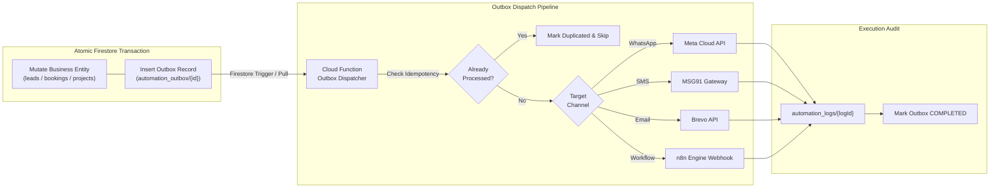
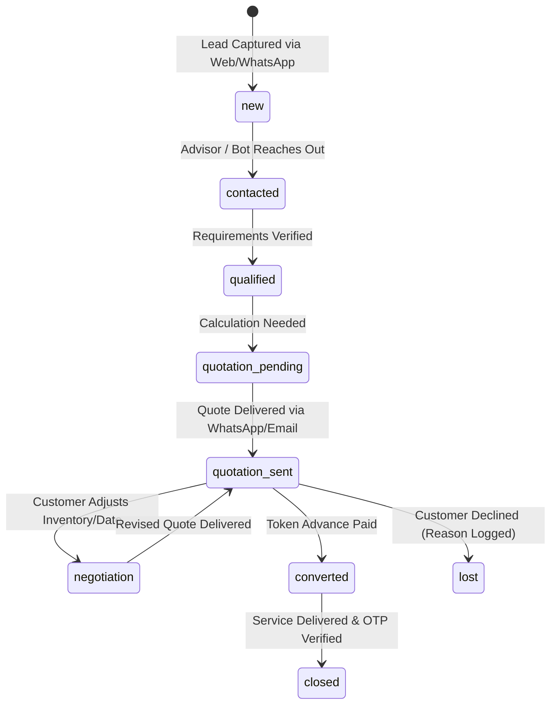
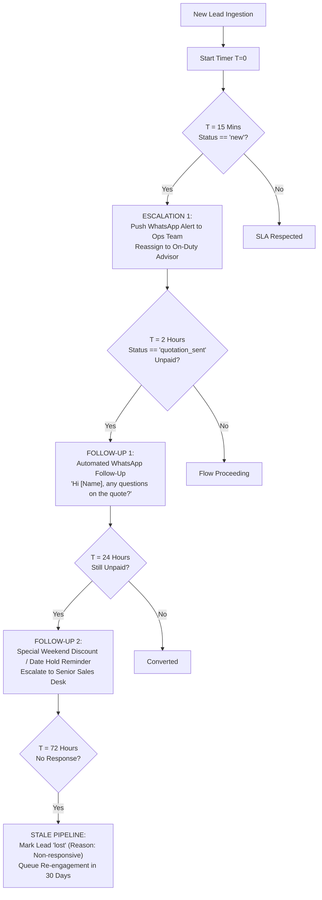

# PACKZEN 3.0 — Priority One Automation Engine Specification
## Event-Driven Architecture, Transactional Outbox & Multi-Channel Workflows

**Document Version:** 3.0.0  
**Status:** Approved Automation Specification  
**Target Environment:** `packzen-e7539`  
**Execution Target:** Cloud Functions v2 (`asia-south1`) + n8n Orchestration Engine  
**Production Channels:** WhatsApp Business Cloud API, MSG91 SMS, Brevo Transactional Email

---

## 1. Event-Driven Transactional Outbox Pattern

To achieve 99.99% automation reliability without data loss or duplicate customer notifications, PackZen 3.0 implements the **Transactional Outbox Pattern** directly on Cloud Firestore.

### 1.1 The Architecture Problem & Solution
- **The Problem:** In a distributed serverless environment, performing an external API call (e.g., sending a WhatsApp message via Meta or SMS via MSG91) inside the same execution block as a database write risks dual-write failure: if the network drops or the external API fails, the database write succeeds while the message is lost; conversely, if the database write fails after the message is sent, ghost notifications occur.
- **The Solution:** Business operations mutate their target entity (e.g., `leads/{id}` or `bookings/{id}`) and simultaneously write an event record into `automation_outbox/{eventId}` inside a single **atomic Firestore transaction**. An asynchronous event consumer then reads the outbox, dispatches the external action with idempotency protections, and updates execution logs.



---

### 1.2 Outbox Event Schema (`automation_outbox`)

```typescript
interface AutomationOutboxEvent {
  eventId: string;                  // Unique UUIDv4 or deterministic hash
  eventType: string;                // e.g. "LEAD_CREATED", "QUOTE_GENERATED", "OTP_REQUESTED"
  division: "logistics" | "home_services" | "digital";
  entityType: "lead" | "booking" | "partner" | "project" | "payment";
  entityId: string;                 // Target document ID
  idempotencyKey: string;           // SHA-256(entityId + eventType + attempt)
  status: "pending" | "processing" | "completed" | "failed" | "dead_letter";
  channel: "whatsapp" | "sms" | "email" | "multi_channel" | "n8n_webhook";
  priority: "p0_immediate" | "p1_high" | "p2_normal" | "p3_low";
  
  // Payload for the channel adapter
  payload: {
    recipientPhone?: string;        // E.164 formatted (+91...)
    recipientEmail?: string;
    customerName?: string;
    templateId: string;             // WhatsApp template name / MSG91 flow ID / Brevo ID
    templateVariables: Record<string, string | number>;
    actionUrl?: string;             // Interactive CTA link (e.g. pay link or tracking link)
    mediaUrl?: string;              // Quotation PDF, invoice, or brochure link
  };

  retryCount: number;               // Current retry attempt (0..5)
  maxRetries: number;               // Max allowed retries (default 3)
  nextRetryAt?: FirebaseFirestore.Timestamp;
  lastError?: string;
  createdAt: FirebaseFirestore.Timestamp;
  updatedAt: FirebaseFirestore.Timestamp;
  processedAt?: FirebaseFirestore.Timestamp;
}
```

---

### 1.3 Idempotency & Exactly-Once Semantics
To prevent duplicate messages to customers during retries or concurrent function executions:
1. Every event carries a deterministic `idempotencyKey`:
   $$\text{idempotencyKey} = \text{SHA256}(\text{entityId} + \text{"\_"} + \text{eventType} + \text{"\_"} + \text{channel})$$
2. Before invoking an external API, the dispatcher checks `automation_logs` using the idempotency key. If a record with status `success` exists for that key, the event is immediately flagged `completed` without calling the external gateway.
3. Every third-party API call includes an idempotency header where supported (e.g., Brevo API headers, Razorpay `X-Razorpay-Idempotency-Key`).

---

## 2. Division-Specific Lifecycle Automation Workflows



---

### 2.1 Logistics Division (Packers & Movers) Workflows

| Trigger Event | Target Channel | Template / Action | Automation Side Effect |
|---|---|---|---|
| **`LEAD_CREATED`** | WhatsApp + SMS | Template: `packzen_lead_ack_v1`<br>CTA: "View Instant Estimate" | Send instant PDF service guide; queue 15-minute advisor response SLA monitor. |
| **`QUOTE_GENERATED`** | WhatsApp + Email | Template: `packzen_logistics_quote_v1`<br>CTA: "Pay ₹999 to Reserve Slot" | Send itemized moving inventory summary with dynamic Razorpay token link. |
| **`PAYMENT_COMPLETED`** | WhatsApp + Email | Template: `packzen_booking_confirmed_v1`<br>Attachments: Tax Invoice & Move Checklist | Convert lead to `bookings/{id}`; transition state to `converted`; trigger driver dispatch queue. |
| **`DRIVER_ASSIGNED`** | WhatsApp | Template: `packzen_driver_assigned_v1`<br>Vars: Driver name, phone, vehicle # | Customer receives driver contact card; driver receives pickup navigation link. |
| **`CREW_ARRIVED`** | WhatsApp | Template: `packzen_crew_arrived_v1`<br>Notice: Live packing initiated | Logs geo-timestamp in booking timeline. |
| **`OTP_GENERATED`** | SMS + WhatsApp | Template: `packzen_completion_otp_v1`<br>Vars: 4-digit secure PIN | Sent to customer phone when driver taps "Complete Move". |
| **`MOVE_COMPLETED`** | WhatsApp | Template: `packzen_review_request_v1`<br>CTA: "Rate on Google Maps" | Dispatched 2 hours post-completion; releases partner wallet balance. |

---

### 2.2 Home Services Division (Appliance, AC, Cleaning) Workflows

| Trigger Event | Target Channel | Template / Action | Automation Side Effect |
|---|---|---|---|
| **`SERVICE_LEAD_NEW`** | WhatsApp | Template: `packzen_homeservice_intake_v1`<br>Quick Replies: "Today", "Tomorrow", "Weekend" | AI Assistant prompts for AC tonnage / appliance brand / issue description. |
| **`SLOT_RESERVED`** | SMS + WhatsApp | Template: `packzen_technician_slot_v1`<br>Vars: Date, 2-hour window, inspection fee | Technician matched based on postal pincode and service capability. |
| **`TECH_DISPATCHED`** | WhatsApp | Template: `packzen_tech_on_the_way_v1`<br>Vars: Tech name, ETA, verified photo | Real-time distance update provided to customer. |
| **`SCOPE_REVISION`** | WhatsApp | Template: `packzen_scope_approval_v1`<br>Vars: Parts cost, revised total | If unexpected repairs are needed on-site, customer must approve via WhatsApp button before work proceeds. |
| **`SERVICE_COMPLETED`** | WhatsApp + Email | Template: `packzen_warranty_card_v1`<br>Attachment: 30-Day Service Guarantee | Digital warranty card issued with technician signature. |
| **`MAINTENANCE_DUE`** | WhatsApp | Template: `packzen_maintenance_reminder_90d`<br>CTA: "Book Preventive Checkup" | Scheduled cron trigger after 90 days for AC filter / appliance checkups. |

---

### 2.3 Digital Solutions Division (Websites, SEO, Growth) Workflows

| Trigger Event | Target Channel | Template / Action | Automation Side Effect |
|---|---|---|---|
| **`DIGITAL_INQUIRY`** | Email + WhatsApp | Template: `packzen_digital_scoping_v1`<br>Link: Scoping Questionnaire | Capture business type, domain name, required features, and budget tier. |
| **`DISCOVERY_BOOKED`** | Email (Google Meet) | Template: `packzen_meeting_invite_v1`<br>Calendar Invite Attached | Adds event to team calendar; triggers SMS reminder 1 hour prior. |
| **`PROPOSAL_DELIVERED`**| Email + WhatsApp | Template: `packzen_digital_proposal_v1`<br>CTA: "Review Proposal & Milestones" | Interactive quote with milestone breakdown (30% Advance, 40% Staging, 30% Go-Live). |
| **`MILESTONE_UNLOCKED`**| WhatsApp + Email | Template: `packzen_milestone_review_v1`<br>Link: Staging preview URL | Client approves milestone with one click or submits change requests. |
| **`PROJECT_GO_LIVE`** | Email | Template: `packzen_handover_v1`<br>Attachments: Admin credentials & DNS records | Triggers retainer support offer and client testimonial request. |

---

## 3. SLA Monitor & Escalation Engine

To eliminate dropped leads and uphold high-velocity response times across Bengaluru:



### SLA Configuration Parameters
- `LEAD_FIRST_RESPONSE_MAX_MINUTES`: 15 minutes.
- `QUOTE_FOLLOWUP_DELAY_HOURS`: 2 hours.
- `QUOTE_EXPIRY_HOURS`: 72 hours.
- `ESCALATION_WHATSAPP_GROUP`: PackZen Operations Rapid Response Team.

---

## 4. n8n Orchestration Engine & Bridge Specification

For multi-step flows requiring decision trees, wait periods, and complex integrations, PackZen 3.0 interfaces with a self-hosted **n8n engine** (hosted on Railway or dedicated VM).

### 4.1 Inbound Webhook Interface (`/n8nWebhook`)
Cloud Functions bridge events to n8n via authenticated webhook endpoints:
- **HTTP Method:** `POST`
- **Headers:**
  - `Content-Type: application/json`
  - `X-PackZen-Signature: sha256=...` (HMAC-SHA256 of the request payload using `N8N_WEBHOOK_SECRET`)
  - `X-PackZen-Timestamp: 1731885000` (Reject if skew > 300 seconds)

### 4.2 Webhook Payload Structure
```json
{
  "eventId": "evt_7f8a9b0c-1234",
  "eventType": "LEAD_CREATED",
  "division": "logistics",
  "entityId": "lead_992182",
  "timestamp": "2026-11-17T16:45:00Z",
  "data": {
    "customer": {
      "name": "Karthik R",
      "phone": "+919876543210",
      "email": "karthik.r@example.com"
    },
    "serviceDetails": {
      "serviceType": "house_shifting",
      "origin": "HSR Layout Sector 2, Bengaluru",
      "destination": "Whitefield, Bengaluru",
      "moveDate": "2026-11-25",
      "size": "2 BHK",
      "liftAvailable": { "origin": true, "destination": true }
    },
    "score": 85,
    "source": "google_ads"
  }
}
```

### 4.3 Resilience & Circuit Breaking
- If the n8n endpoint returns `5xx` or times out (> 10s), the Cloud Functions dispatcher increments `retryCount`, calculates exponential backoff ($2^{\text{retryCount}} \times 60\text{ seconds}$), and reschedules the event in `automation_outbox`.
- After 5 consecutive failures, the event transitions to `dead_letter` and an instant alert is pushed to the PackZen system administrator.

---

## 5. Third-Party Multi-Channel Gateway Specifications

### 5.1 WhatsApp Business Cloud API (Meta)
- **API Version:** Graph API `v21.0`
- **Endpoint:** `https://graph.facebook.com/v21.0/{PHONE_NUMBER_ID}/messages`
- **Authentication:** Bearer token loaded from Secret Manager (`WHATSAPP_API_TOKEN`).
- **Template Payload Example:**
```json
{
  "messaging_product": "whatsapp",
  "recipient_type": "individual",
  "to": "919876543210",
  "type": "template",
  "template": {
    "name": "packzen_quote_delivery_v1",
    "language": { "code": "en" },
    "components": [
      {
        "type": "header",
        "parameters": [
          { "type": "document", "document": { "link": "https://packzenblr.in/docs/quote_123.pdf", "filename": "PackZen_Quotation.pdf" } }
        ]
      },
      {
        "type": "body",
        "parameters": [
          { "type": "text", "text": "Karthik" },
          { "type": "text", "text": "2 BHK House Shifting" },
          { "type": "text", "text": "₹8,499" }
        ]
      },
      {
        "type": "button",
        "sub_type": "url",
        "index": "0",
        "parameters": [{ "type": "text", "text": "pay_992182" }]
      }
    ]
  }
}
```

### 5.2 MSG91 SMS Gateway (DLT Compliant)
- **Endpoint:** `https://api.msg91.com/api/v5/flow/`
- **Headers:** `authkey: <MSG91_AUTH_KEY>`, `content-type: application/json`
- **Payload Structure:**
```json
{
  "template_id": "6739a8b1d6e4f2019c0012a4",
  "short_url": "1",
  "recipients": [
    {
      "mobiles": "919876543210",
      "NAME": "Karthik",
      "OTP": "4892",
      "BOOKING_ID": "PZ-BLR-8812"
    }
  ]
}
```

### 5.3 Brevo (Sendinblue) Transactional Email
- **Library:** `@getbrevo/brevo`
- **Configuration:** Transactional email API with verified sender `care@packzenblr.in`.
- **Payload Structure:**
```javascript
const sendSmtpEmail = new brevo.SendSmtpEmail();
sendSmtpEmail.templateId = 12; // PackZen Tax Invoice & Service Voucher
sendSmtpEmail.to = [{ email: "karthik.r@example.com", name: "Karthik R" }];
sendSmtpEmail.params = {
  CUSTOMER_NAME: "Karthik R",
  ORDER_ID: "PZ-BLR-8812",
  AMOUNT_PAID: "₹999",
  BALANCE_DUE: "₹7,500",
  MOVE_DATE: "25 Nov 2026"
};
```
