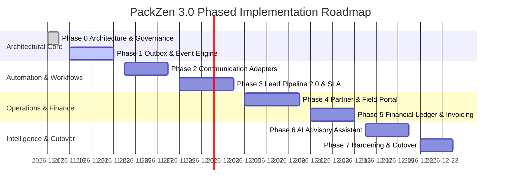
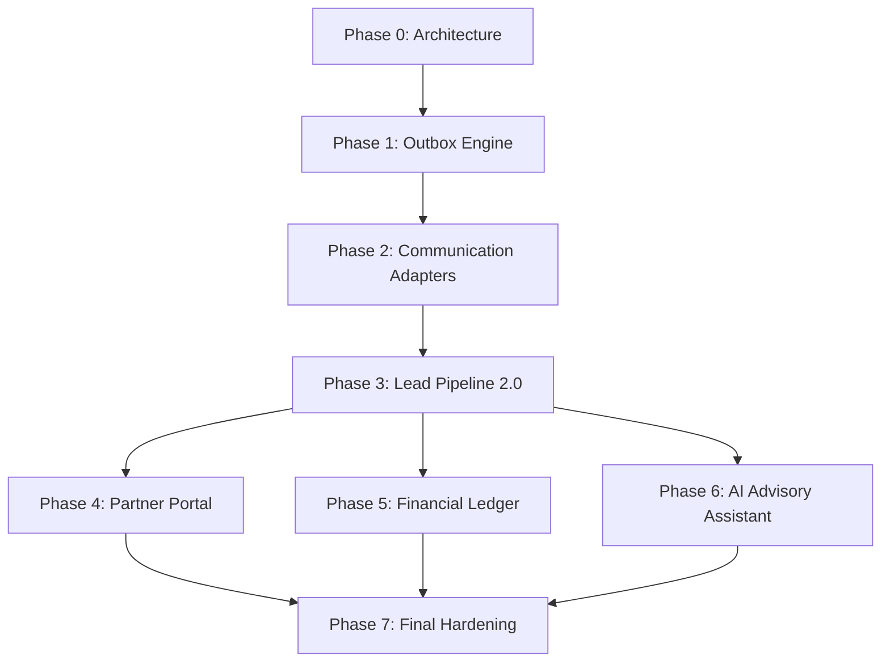

# PACKZEN 3.0 — Phased Implementation Roadmap
## Work Breakdown Structure, Milestones, Dependencies & Delivery Schedule

**Document Version:** 3.0.0  
**Status:** Approved Phased Implementation Roadmap  
**Target Environment:** `packzen-e7539`  
**Execution Methodology:** Phased Delivery, Isolated Testing, Controlled Production Gates

---

## 1. Master Phased Delivery Overview

PackZen 3.0 follows an 8-phase implementation model (Phases 0 through 7). Each phase builds upon the previous phase's verified foundation without interrupting live operations on `https://packzenblr.in`:

---

## 2. Phase-by-Phase Work Breakdown Structure (WBS)

### Phase 0: Architecture, Data Modeling & Governance
*Status:* **COMPLETE (Current Release Gate)**
- **Deliverables:**
  - Complete 6-layer platform architecture (`PACKZEN_3_ARCHITECTURE.md`).
  - Priority One transactional outbox and multi-channel specification (`PACKZEN_AUTOMATION_SPEC.md`).
  - Firestore database schemas, composite index definitions, and partitioning plans (`PACKZEN_DATA_MODEL.md`).
  - Zero-trust security review, RBAC matrix, and least-privilege security rules (`PACKZEN_SECURITY_REVIEW.md`).
  - Comprehensive multi-tier test plan (`PACKZEN_TEST_PLAN.md`).
  - Controlled, zero-downtime release protocol (`PACKZEN_RELEASE_PLAN.md`).
- **Gate Criteria:** Owner review and formal sign-off.

---

### Phase 1: Automation Outbox Core & Event Bus
*Objective:* Implement the transactional outbox engine in Cloud Functions without external channel dependencies.
- **Key Tasks:**
  1. Create `functions/automation-outbox.js` implementing atomic Firestore transaction helpers (`enqueueOutboxEvent`).
  2. Implement idempotent event deduplication using SHA-256 idempotency key hashing.
  3. Deploy Cloud Function `processOutboxQueue` (scheduled pull + Firestore trigger).
  4. Build exponential backoff retry handler (max 5 attempts, dead-letter archiving).
  5. Deploy Firestore Security Rules updates for `automation_outbox`, `automation_events`, `automation_logs`.
- **Milestone 1:** 100% of local outbox unit tests pass in Firestore Emulator with 0 duplicated events under simulated network failure.

---

### Phase 2: Communication Adapters (WhatsApp, SMS, Email) & n8n Bridge
*Objective:* Connect the outbox engine to real-world communication gateways.
- **Key Tasks:**
  1. Build WhatsApp Cloud API adapter (`functions/channel-whatsapp.js`) with Meta template payloads.
  2. Implement MSG91 DLT transactional SMS adapter (`functions/channel-sms.js`).
  3. Standardize Brevo transactional email client (`functions/channel-email.js`).
  4. Implement secure inbound/outbound n8n webhook bridge (`functions/automation-bridge.js`) with HMAC-SHA256 signatures and timestamp validation.
  5. Configure communication preference checks (opt-out suppression and quiet hours).
- **Milestone 2:** End-to-end sandbox dispatch successfully delivers WhatsApp, SMS, and Email payloads with audited latency < 1500ms.

---

### Phase 3: Lead Pipeline 2.0 (3 Divisions, 9 Auditable Statuses, SLA Monitors)
*Objective:* Upgrade lead intake, lifecycle management, and SLA enforcement.
- **Key Tasks:**
  1. Upgrade `functions/leads.js` (`submitLead`) to validate multi-division schemas (`logistics`, `home_services`, `digital`).
  2. Upgrade `public/leads-app/` and `public/admin-ecosystem.js` to render the 9-stage Kanban pipeline with division tabs.
  3. Implement the 15-minute SLA background monitor function (`checkLeadResponseSLA`).
  4. Implement automated quotation generation function (`createSentQuoteV2`) supporting itemized moving inventory, appliance flat rates, and digital scope packages.
  5. Add audit logging for status transition reasons (especially `"lost"`).
- **Milestone 3:** Lead conversion through 9 stages verified across all three divisions in test environment with active SLA triggers.

---

### Phase 4: Partner & Field Operations Portal
*Objective:* Streamline partner onboarding, dispatch broadcasting, and completion verification.
- **Key Tasks:**
  1. Enhance partner web portals (`partner-register.html`, `partner-dashboard.html`) with document upload to Cloud Storage.
  2. Deploy partner verification API (`adminReviewPartnerV2`) for Aadhaar/DL/RC approval.
  3. Implement live job dispatch broadcasting with PII masking (unassigned partners see locality only).
  4. Upgrade driver/technician execution console (`driver.html`) for low-bandwidth mobile devices.
  5. Secure OTP completion flow (`completion-otp.js`) requiring customer PIN and photo proof of service.
- **Milestone 4:** Full dispatch lifecycle tested: Job Created $\rightarrow$ Broadcast $\rightarrow$ Partner Claim $\rightarrow$ Geo-Check-in $\rightarrow$ Customer OTP Verification $\rightarrow$ Wallet Credit.

---

### Phase 5: Financial Ledger & Invoicing Engine
*Objective:* Implement auditable double-entry aligned accounting and automated invoicing.
- **Key Tasks:**
  1. Create `functions/ledger-service.js` to record atomic credits and debits for advances, balance collections, partner payouts, and payment gateway fees.
  2. Connect Razorpay webhook handler directly to the ledger engine.
  3. Build automated GST tax invoice generator generating branded PDF vouchers.
  4. Implement partner payout reconciliation dashboard in `admin.html`.
  5. Add unit tests verifying net margin calculations: $\text{Margin} = \text{Gross Collections} - (\text{Partner Payout} + \text{Gateway Fees})$.
- **Milestone 5:** 100% of simulated transactions reconcile with zero balance discrepancy across 1,000 randomized test orders.

---

### Phase 6: AI Advisory Assistant
*Objective:* Deploy advisory AI capabilities with strict human-in-the-loop guardrails.
- **Key Tasks:**
  1. Upgrade `functions/assistant-ai.js` using Gemini 1.5 Flash for high-speed multi-lingual inquiry parsing.
  2. Implement entity extraction: auto-detect origin, destination, BHK size, appliance brand, or digital scope.
  3. Implement quotation draft generator that outputs structured recommendation objects without writing to production booking records.
  4. Implement lead urgency and intent scoring algorithm (1-100 score).
  5. Build advisor review interface in `advisor.html` allowing staff to accept, modify, or reject AI suggestions with one click.
- **Milestone 6:** AI correctly extracts entities from 50 complex unstructured customer inquiries with > 95% accuracy and zero unapproved database mutations.

---

### Phase 7: Hardening, Performance Optimization & Production Cutover
*Objective:* Final integration testing, performance audits, and controlled production activation.
- **Key Tasks:**
  1. Execute comprehensive automated test suite (Unit, Rules, Outbox, Mocks, Browser E2E).
  2. Run Lighthouse Core Web Vitals audit ensuring P95 load time < 1.2s across mobile.
  3. Deploy required Firestore composite indexes.
  4. Perform staged production release following `PACKZEN_RELEASE_PLAN.md`.
  5. Verify live production telemetry via synthetic smoke test scripts.
- **Milestone 7:** System successfully live on `https://packzenblr.in` with zero production regressions.

---

## 3. Dependency Map & Critical Path

*Critical Path Analysis:* Phase 1 (Outbox Engine) and Phase 2 (Communication Adapters) represent the foundational backbone. Phase 3 (Pipeline), Phase 4 (Partners), and Phase 5 (Ledger) can proceed in rapid succession once the outbox is verified.

---

## 4. Risk Matrix & Mitigation Strategies

| Identified Risk | Severity | Likelihood | Mitigation Strategy |
|---|:---:|:---:|---|
| **WhatsApp Template Rejection by Meta** | Medium | Medium | Pre-submit templates during Phase 1 with strict business policy compliance; maintain SMS as fallback. |
| **Outbox Worker Deadlocks / Concurrency** | High | Low | Use deterministic Firestore transaction locks and distinct idempotency keys per event attempt. |
| **Accidental Live PII Exposure** | Critical | Very Low | Enforce Firestore Security Rules denying client-side reading of `automation_outbox` and partner PII masking. |
| **Slow Firestore Compound Queries** | Medium | Low | Deploy all required composite indexes into `firestore.indexes.json` prior to deploying application code. |
| **Production Parameter Deployment Blockers** | High | Low | Maintain validated `.env` parameter configurations in `functions/` with automated `--dry-run` verification. |
