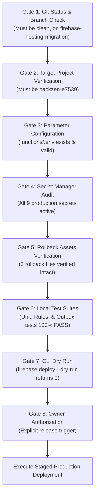
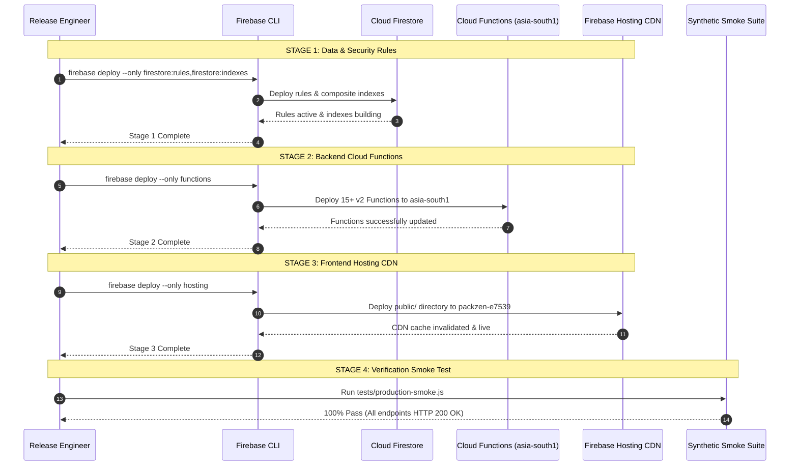

# PACKZEN 3.0 — Controlled Production Release & Rollback Plan
## Preflight Gates, Staged Manifests, Failure Protocols & Instant Rollback Procedures

**Document Version:** 3.0.0  
**Status:** Approved Release Protocol  
**Production Target:** `packzen-e7539`  
**Production Domain:** https://packzenblr.in  
**Branch:** `firebase-hosting-migration`  
**Baseline Commit:** `0c3f91264c123689626c59bce2cf4c3ae63ea25a`

---

## 1. Zero-Downtime Release Philosophy

Production deployments to PackZen operate under strict zero-downtime and non-destructive change protocols. Because `packzenblr.in` serves active logistics customers, field drivers, and business inquiries across Bengaluru:
1. **Database Schema Backward Compatibility:** All new Firestore collections and field additions are additive; existing code must continue functioning without disruption.
2. **Atomic Rollback Readiness:** Rollback configurations and verified baseline assets (`firebase.rollback.json`, `firestore.rules.prod_backup`, `functions_prod_backup/`) must exist and be verified before any deployment command executes.
3. **Sequential Staging with Failure Gates:** Deployments execute in strict topological order: Rules & Indexes $\rightarrow$ Backend Functions $\rightarrow$ Frontend Hosting. Any failure triggers an immediate halt and automated rollback.

---

## 2. Preflight Release Gates (Mandatory Checklist)

Before issuing any production deployment command, all 8 preflight checks must report `PASS`:



### Preflight Verification Table

| Gate # | Check Description | Verification Command / Target | Pass Criteria |
|---|---|---|---|
| **Gate 1** | Git Working Tree | `git status --porcelain` | Clean; 0 uncommitted application files. |
| **Gate 2** | Firebase Project Target | `firebase use` | Explicitly confirms active: `packzen-e7539`. |
| **Gate 3** | Functions Parameters | `Test-Path functions/.env` | File exists; contains `PACKZEN_ACTION_URL` and `PACKZEN_LOGO_URL`. |
| **Gate 4** | Secrets Access | `gcloud secrets list --project=packzen-e7539` | All 9 secrets present and accessible. |
| **Gate 5** | Rollback Readiness | `Test-Path firebase.rollback.json`, `firestore.rules.prod_backup`, `functions_prod_backup` | All 3 rollback assets verified intact. |
| **Gate 6** | Automated Test Suites | `npm test` across root and `functions/` | 100% passing tests (0 failures, 0 skipped). |
| **Gate 7** | Deployment Dry Run | `npx firebase-tools deploy --only firestore:rules --dry-run` | Returns exit code 0. |
| **Gate 8** | Owner Sign-Off | Explicit turn approval from platform owner | Authorized. |

---

## 3. Staged Production Deployment Manifest



---

### Stage 1: Deploy Firestore Security Rules & Indexes
- **Objective:** Establish security boundaries before code that accesses new collections goes live.
- **Execution Command:**
  ```powershell
  npx firebase-tools deploy --only firestore:rules,firestore:indexes --project packzen-e7539 --non-interactive
  ```
- **Verification:** Confirm Firestore console reports rules compilation success and index builds initiated.

---

### Stage 2: Deploy Cloud Functions v2
- **Objective:** Deploy updated backend functions to `asia-south1` with Secret Manager bindings and environment parameters.
- **Execution Command:**
  ```powershell
  npx firebase-tools deploy --only functions --project packzen-e7539 --non-interactive
  ```
- **Verification:** Inspect Cloud Functions console; verify all functions report green status with 0 deployment crash loops.

---

### Stage 3: Deploy Firebase Hosting
- **Objective:** Deploy static assets, landing pages, and administrative consoles.
- **Execution Command:**
  ```powershell
  npx firebase-tools deploy --only hosting --project packzen-e7539 --non-interactive
  ```
- **Verification:** Edge CDN invalidation completes; version tagged in Firebase Hosting release history.

---

### Stage 4: Live Synthetic Smoke Test
- **Execution Command:**
  ```powershell
  node tests/production-smoke.js
  ```
- **Required Outcomes:**
  - `https://packzenblr.in/` $\rightarrow$ `200 OK`
  - `https://packzenblr.in/digital/` $\rightarrow$ `200 OK`
  - `https://packzenblr.in/admin.html` $\rightarrow$ `200 OK`
  - `https://packzenblr.in/advisor.html` $\rightarrow$ `200 OK`
  - `https://packzenblr.in/driver.html` $\rightarrow$ `200 OK`
  - Preflight `OPTIONS /submitLead` $\rightarrow$ `204 No Content`

---

## 4. Emergency Rollback Protocols

If any deployment stage fails, reports an unexpected error, or if post-release metrics show anomalies, the following component-specific rollback protocols execute immediately.

### 4.1 Cloud Functions Rollback (Zero Source Overwrite)
Rollback executes strictly using the verified backup configuration `firebase.rollback.json`, which points directly to `functions_prod_backup/`:
```powershell
npx firebase-tools deploy --only functions --config firebase.rollback.json --project packzen-e7539 --non-interactive
```
*Note: This leaves the current `functions/` development directory completely intact while instantly restoring the previous stable production binaries in `asia-south1`.*

### 4.2 Firestore Security Rules Rollback
```powershell
npx firebase-tools deploy --only firestore:rules --config firebase.rollback.json --project packzen-e7539 --non-interactive
```
*Instantly restores the rules from `firestore.rules.prod_backup`.*

### 4.3 Firebase Hosting Rollback
```powershell
# Instant one-click rollback to previous release version via Firebase CLI
npx firebase-tools hosting:rollback --project packzen-e7539 --non-interactive
```

---

## 5. Post-Release Operational Monitoring Plan

Following successful deployment:
1. **Google Cloud Logging Monitoring (First 60 Minutes):**
   Filter for severe errors:
   `resource.type="cloud_function" AND severity>=ERROR`
2. **Outbox Telemetry:**
   Query `automation_outbox` for any events in `dead_letter` status or retry counts $> 2$.
3. **Payment Webhook Audit:**
   Verify Razorpay webhook callback latency and signature verification success rate is 100%.
4. **Lead Intake Audit:**
   Verify test lead ingestion produces expected outbox entries and SMS/WhatsApp acknowledgments within 5 seconds.
