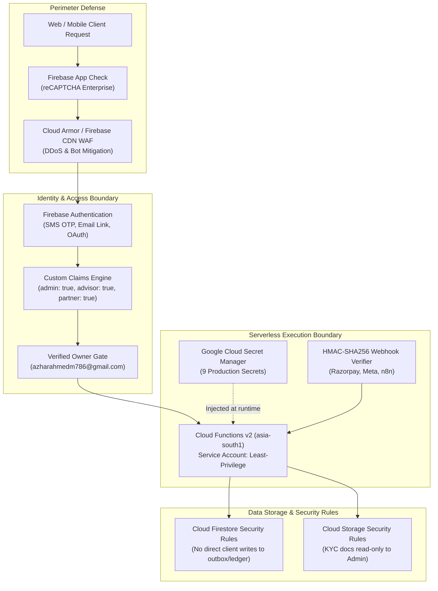

# PACKZEN 3.0 — Zero-Trust Security Architecture & Threat Model
## Least-Privilege Rules, Identity Governance, PII Protection & Secrets Management

**Document Version:** 3.0.0  
**Status:** Approved Security Specification  
**Target Environment:** `packzen-e7539`  
**Security Posture:** Zero-Trust, Least-Privilege, Defense-in-Depth

---

## 1. Threat Model & Security Posture

PackZen 3.0 operates in a multi-tenant environment handling customer personally identifiable information (PII), geographic location data, field operations dispatch, and online financial transactions across three divisions. The security architecture assumes an untrusted network environment and strictly enforces verification at every boundary.



---

## 2. Role-Based Access Control (RBAC) Hierarchy

The platform implements five distinct access tiers with hard boundary isolation:

```
[ Tier 0: Platform Owner ] ─────── azharahmedm786@gmail.com (Root Authority)
            │
[ Tier 1: Platform Admin ] ─────── Manage Staff, Ledger, System Settings, Full Rules
            │
[ Tier 2: Operations / Advisor ] ─ Manage Leads, Dispatch Jobs, Issue Quotes
            │
[ Tier 3: Field Partner ] ──────── View Assigned Jobs, Verify OTP, Claim Offers
            │
[ Tier 4: End Customer ] ───────── View Own Booking, Make Payments, Track Move
```

### 2.1 Role Capabilities Matrix

| Resource / Capability | Tier 0 (Owner) | Tier 1 (Admin) | Tier 2 (Advisor) | Tier 3 (Partner) | Tier 4 (Customer) | Anonymous / Public |
|---|:---:|:---:|:---:|:---:|:---:|:---:|
| **Submit Public Lead** | Yes | Yes | Yes | Yes | Yes | Via `submitLead` API only |
| **View Leads Pipeline** | Full Access | Full Access | Full Access | Denied | Denied | Denied |
| **Create / Send Quotations** | Full Access | Full Access | Full Access | Denied | Denied | Denied |
| **View Bookings** | All | All | All | Assigned Only | Own Only | Denied |
| **Verify Completion OTP** | Yes | Yes | Yes | Assigned Job | Denied | Denied |
| **View Partner KYC / Wallet** | All | All | Denied | Own Profile | Denied | Denied |
| **Approve Partner KYC** | Yes | Yes | Denied | Denied | Denied | Denied |
| **Manage Staff Roles** | Root Only | Denied | Denied | Denied | Denied | Denied |
| **Read / Write Financial Ledger**| Full Access | Full Access | Read-Only | Denied | Denied | Denied |
| **Automation Outbox / Logs** | Admin Only | Admin Only | Denied | Denied | Denied | Denied (No client access) |

---

## 3. Firestore Security Rules Specifications

The following rules formalize the security posture across all existing and PackZen 3.0 collections:

```javascript
rules_version = '2';
service cloud.firestore {
  match /databases/{database}/documents {

    // Helper functions for zero-trust authorization
    function isAuthenticated() {
      return request.auth != null;
    }

    function isOwner() {
      return isAuthenticated() && 
        (request.auth.token.email == 'azharahmedm786@gmail.com' ||
         request.auth.uid == 'v4q3Uv2nN5Z5G4vNq7P7n9x2Z3A3'); // Production Owner UID
    }

    function isAdmin() {
      return isOwner() || 
        (isAuthenticated() && (
          request.auth.token.admin == true ||
          get(/databases/$(database)/documents/staff_roles/$(request.auth.uid)).data.role == 'admin'
        ));
    }

    function isAdvisor() {
      return isAdmin() || 
        (isAuthenticated() && (
          request.auth.token.advisor == true ||
          get(/databases/$(database)/documents/staff_roles/$(request.auth.uid)).data.role == 'advisor'
        ));
    }

    function isPartner() {
      return isAuthenticated() && (
        request.auth.token.partner == true ||
        request.auth.token.driver == true
      );
    }

    // 1. LEADS: Direct client creation prohibited to prevent scraping and spam.
    // Must be ingested through validated submitLead Cloud Function.
    match /leads/{leadId} {
      allow create: if false;
      allow read, update, delete: if isAdvisor();
    }

    // 2. BOOKINGS: Customers access only their own records; partners access assigned jobs; staff accesses all.
    match /bookings/{bookingId} {
      allow read: if isAdvisor() || 
        (isAuthenticated() && resource.data.customer.phone == request.auth.token.phone_number) ||
        (isPartner() && resource.data.assignedPartner.partnerId == request.auth.uid);
      
      // Updates strictly gated to staff or specific verified serverless endpoints
      allow update: if isAdvisor();
      allow create, delete: if isAdmin();

      match /timeline/{milestoneId} {
        allow read: if isAdvisor() || 
          (isAuthenticated() && get(/databases/$(database)/documents/bookings/$(bookingId)).data.customer.phone == request.auth.token.phone_number);
        allow write: if isAdvisor();
      }
    }

    // 3. PARTNERS: Partners can view/edit limited personal info, but cannot alter approval status or wallet balance.
    match /partners/{partnerId} {
      allow read: if isAdmin() || (isAuthenticated() && request.auth.uid == partnerId);
      allow create: if isAuthenticated() && request.auth.uid == partnerId;
      allow update: if isAdmin() || (
        isAuthenticated() && 
        request.auth.uid == partnerId && 
        !request.resource.data.diff(resource.data).affectedKeys().hasAny([
          'verificationStatus', 'walletBalance', 'rating', 'jobsCompleted', 'payoutDetails'
        ])
      );
      allow delete: if isAdmin();
    }

    // 4. PROJECTS: Digital solutions engagements
    match /projects/{projectId} {
      allow read: if isAdvisor() || (isAuthenticated() && resource.data.client.uid == request.auth.uid);
      allow write: if isAdvisor();
    }

    // 5. FINANCIAL LEDGER: Strictly confidential
    match /ledger/{txnId} {
      allow read, write: if isAdmin();
    }

    // 6. PRIORITY ONE AUTOMATION ENGINE: Absolute Zero Client Access
    // Outbox, raw events, logs, and preferences are manipulated strictly by Admin SDK in Cloud Functions.
    match /automation_outbox/{eventId} {
      allow read, write: if false;
    }
    match /automation_events/{eventId} {
      allow read, write: if false;
    }
    match /automation_logs/{logId} {
      allow read, write: if false;
    }
    match /automation_templates/{templateId} {
      allow read: if isAdvisor();
      allow write: if isAdmin();
    }
    match /automation_preferences/{prefId} {
      allow read, write: if false;
    }

    // 7. STAFF GOVERNANCE: Only the root owner can assign or alter staff roles
    match /staff_roles/{staffId} {
      allow read: if isAuthenticated();
      allow write: if isOwner();
    }

    // 8. SYSTEM CONFIGURATION & SCENARIOS
    match /settings/{settingId} {
      allow read: if isAuthenticated();
      allow write: if isAdmin();
    }
  }
}
```

---

## 4. Personally Identifiable Information (PII) Protection & Data Masking

To prevent customer data harvesting and comply with Indian Digital Personal Data Protection Act (DPDP) standards:

### 4.1 Field Partner Data Masking
1. **Unclaimed Job Offers:** When a move or service lead is broadcast to partner devices, sensitive PII is stripped:
   - Full customer name is replaced with initial: `Karthik R.` $\rightarrow$ `Karthik R.`
   - Customer phone number is **completely omitted**.
   - Specific house/flat number is omitted; only the broad pickup/drop localities are displayed (`HSR Layout Sector 2` $\rightarrow$ `Whitefield`).
2. **Claimed Jobs:** Full phone numbers and street addresses are revealed to the partner **only after** formal claim acceptance.
3. **Completed Jobs:** Customer contact details are automatically redacted from the partner console 24 hours after completion OTP verification.

---

## 5. Webhook Security & Anti-Replay Defense

All incoming webhooks (Razorpay, WhatsApp Business API, and n8n orchestration triggers) enforce strict cryptographic validation:

### 5.1 Razorpay Payment Webhook Verification
- The raw request body is verified against the signature in `x-razorpay-signature` using HMAC-SHA256:
```javascript
const expectedSignature = crypto
  .createHmac('sha256', process.env.RAZORPAY_WEBHOOK_SECRET)
  .update(rawBody)
  .digest('hex');

if (expectedSignature !== req.headers['x-razorpay-signature']) {
  throw new Error('UNAUTHORIZED_WEBHOOK_SIGNATURE');
}
```

### 5.2 n8n / Internal Webhook Timestamp Validation
- Requests carry `X-PackZen-Timestamp`. If the timestamp deviates by more than **300 seconds** (5 minutes) from server time, the request is rejected immediately to neutralize replay attacks.

---

## 6. Secret Governance & Google Cloud Secret Manager Audit

Production credentials never reside in source code or Git history. All sensitive values are managed through Google Cloud Secret Manager:

| Secret Identifier | Purpose | Access Scope |
|---|---|---|
| `RAZORPAY_KEY_ID` | Payment gateway public identifier | Cloud Functions (`asia-south1`) |
| `RAZORPAY_KEY_SECRET` | Order signing and capture | Cloud Functions (`asia-south1`) |
| `RAZORPAY_WEBHOOK_SECRET` | Webhook callback signature verification | `functions/payment-webhook.js` |
| `BREVO_API_KEY` | Transactional email delivery | `functions/brevo-client.js` |
| `MSG91_AUTH_KEY` | DLT-compliant transactional SMS & OTPs | `functions/channel-sms.js` |
| `WHATSAPP_API_TOKEN` | Meta WhatsApp Cloud API Bearer Token | `functions/channel-whatsapp.js` |
| `WHATSAPP_APP_SECRET` | Inbound WhatsApp webhook verification | `functions/channel-whatsapp.js` |
| `MAPS_API_KEY` | Geocoding & Distance Matrix pricing | `functions/pricing-engine-v2.js` |
| `N8N_WEBHOOK_SECRET` | Shared secret for workflow orchestration | `functions/automation-bridge.js` |

### Secret Ingestion Protocol
In local emulator and test environments, mock secrets are loaded via Git-ignored `.env` files. In production, Cloud Functions v2 injects secrets directly into function memory via Cloud Secret Manager bindings, preventing disk leaks.
