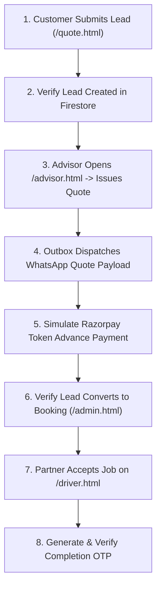

# PACKZEN 3.0 — Comprehensive Multi-Tier Test Plan
## Unit Tests, Emulator Security Rules, Outbox Integration, E2E & Smoke Testing

**Document Version:** 3.0.0  
**Status:** Approved Quality Assurance Specification  
**Target Environment:** Local Firebase Emulator Suite + Production Smoke Verification  
**Coverage Target:** > 90% Business Logic & 100% Security Rules Branch Coverage

---

## 1. Testing Strategy & Multi-Tier Test Pyramid

To guarantee bulletproof stability, zero regression of live features, and complete data safety, PackZen 3.0 implements a five-tier testing strategy:

```
               / \
              /   \      Tier 5: Synthetic Production Smoke Checks (Live HTTPS)
             /     \
            /  E2E  \    Tier 4: Browser E2E Workflows (Chrome DevTools / Playwright)
           /---------\
          /  Integ    \  Tier 3: Outbox Concurrency & Webhook Mock Tests
         /-------------\
        /  Sec Rules    \ Tier 2: Firestore Emulator Security Rules Unit Tests
       /-----------------\
      /     Unit Tests    \ Tier 1: Pure Function & Algorithm Unit Tests
     /---------------------\
```

---

## 2. Tier 1: Pure Logic Unit Tests

Unit tests execute without network dependencies, verifying core business math, state transitions, and cryptography.

### 2.1 Pricing & Quotation Algorithms (`tests/unit/pricing.test.js`)
- **Logistics Distance & Volume Calculation:**
  - Verify base rate, floor elevation surcharge (with/without elevator), packing tier (Standard vs Premium), and distance multiplier calculations across Bengaluru pincodes.
  - Verify dynamic token advance calculation: fixed ₹999 for local moves < ₹15,000; 20% for intercity moves > ₹20,000.
- **Home Services Fixed & Variable Rates:**
  - Verify standard AC split service flat rate (₹499) + gas refill pricing by weight/tonnage.
- **Digital Solutions Milestone Math:**
  - Verify 3-phase split: 30% Advance + 40% Staging + 30% Go-Live sums to exactly 100% of total project value.

### 2.2 Pipeline State Machine Invariants (`tests/unit/state-machine.test.js`)
- Test all 9 valid transitions:
  `new` $\rightarrow$ `contacted` $\rightarrow$ `qualified` $\rightarrow$ `quotation_pending` $\rightarrow$ `quotation_sent` $\rightarrow$ `negotiation` $\rightarrow$ `converted` $\rightarrow$ `closed`.
- Assert rejection of illegal transitions (e.g. attempting to jump from `new` directly to `converted` without quotation or payment).
- Assert that transitioning to `"lost"` mandates a populated `statusReason` string.

### 2.3 Idempotency Key Hasher (`tests/unit/idempotency.test.js`)
- Assert that identical payloads produce identical SHA-256 idempotency hashes.
- Assert that whitespace and field reordering do not alter deterministic hash outputs.

---

## 3. Tier 2: Firestore Security Rules Test Suite (`@firebase/rules-unit-testing`)

The security rules test suite runs inside the local Firestore Emulator (`localhost:8080`) to prove that access boundaries cannot be bypassed.

### 3.1 Test Scenarios & Expectations

```javascript
const { initializeTestEnvironment, assertFails, assertSucceeds } = require('@firebase/rules-unit-testing');
const fs = require('fs');

describe('PackZen 3.0 Security Rules Verification', () => {
  let testEnv;

  beforeAll(async () => {
    testEnv = await initializeTestEnvironment({
      projectId: 'packzen-e7539-test',
      firestore: {
        rules: fs.readFileSync('firestore.rules', 'utf8'),
        host: '127.0.0.1',
        port: 8080
      }
    });
  });

  afterAll(async () => {
    await testEnv.cleanup();
  });

  // 1. Direct Client Write to Outbox Must Fail
  test('Anonymous or authenticated client CANNOT write directly to automation_outbox', async () => {
    const unauthDb = testEnv.unauthenticatedContext().firestore();
    const userDb = testEnv.authenticatedContext('user_123').firestore();

    await assertFails(unauthDb.collection('automation_outbox').doc('evt_1').set({ test: true }));
    await assertFails(userDb.collection('automation_outbox').doc('evt_2').set({ test: true }));
  });

  // 2. Direct Client Write to Ledger Must Fail
  test('Regular user CANNOT read or write to financial ledger', async () => {
    const userDb = testEnv.authenticatedContext('user_123').firestore();
    await assertFails(userDb.collection('ledger').doc('txn_1').set({ amount: 1000 }));
    await assertFails(userDb.collection('ledger').doc('txn_1').get());
  });

  // 3. Admin Can Read/Write Ledger
  test('Verified admin CAN access financial ledger', async () => {
    const adminDb = testEnv.authenticatedContext('admin_uid', {
      email: 'azharahmedm786@gmail.com',
      admin: true
    }).firestore();

    await assertSucceeds(adminDb.collection('ledger').doc('txn_1').set({
      amount: 5000,
      type: 'customer_advance',
      division: 'logistics'
    }));
  });

  // 4. Client Cannot Create Leads Directly (Must use submitLead Cloud Function)
  test('Direct client create on leads/ is DENIED', async () => {
    const userDb = testEnv.unauthenticatedContext().firestore();
    await assertFails(userDb.collection('leads').doc('lead_direct').set({
      customer: { name: 'Attacker' }
    }));
  });

  // 5. Partner Cannot Tamper with Wallet or Verification Status
  test('Partner cannot self-approve KYC or alter wallet balance', async () => {
    const partnerId = 'partner_99';
    await testEnv.withSecurityRulesDisabled(async (adminFs) => {
      await adminFs.collection('partners').doc(partnerId).set({
        partnerId,
        verificationStatus: 'pending_kyc',
        walletBalance: 0
      });
    });

    const partnerDb = testEnv.authenticatedContext(partnerId, { partner: true }).firestore();
    
    // Changing personal phone is allowed
    await assertSucceeds(partnerDb.collection('partners').doc(partnerId).update({
      phone: '+919988776655'
    }));

    // Attempting to self-verify or add money to wallet is DENIED
    await assertFails(partnerDb.collection('partners').doc(partnerId).update({
      verificationStatus: 'verified'
    }));
    await assertFails(partnerDb.collection('partners').doc(partnerId).update({
      walletBalance: 50000
    }));
  });
});
```

---

## 4. Tier 3: Outbox Concurrency, Idempotency & Webhook Mocks

### 4.1 Concurrent Worker Race Condition Simulation
- **Setup:** Launch 10 parallel asynchronous promises attempting to process the same `pending` outbox event simultaneously.
- **Verification:** Using Firestore transaction locks, exactly 1 worker successfully claims status `processing`; the remaining 9 workers receive `ALREADY_PROCESSING` and gracefully exit without calling external channel APIs.

### 4.2 Gateway Error Recovery & Backoff Verification
- **Setup:** Configure external gateway mock to return HTTP `503 Service Unavailable`.
- **Execution:** Trigger `processOutboxQueue`.
- **Verification:**
  1. Event status remains `pending`.
  2. `retryCount` increments from `0` to `1`.
  3. `nextRetryAt` is set to $T + 60\text{ seconds}$.
  4. Error log is written to `automation_logs`.
  5. On 6th attempt, event transitions to `dead_letter` and triggers administrative notification.

### 4.3 Webhook HMAC-SHA256 Signature Validation
- Test valid signature passes with HTTP 200.
- Test tampered body with valid signature fails with HTTP 401.
- Test valid signature with expired timestamp (> 300s) fails with HTTP 401.

---

## 5. Tier 4: Browser End-to-End User Workflows

Using Playwright and Chrome DevTools MCP:



### Critical Journey Checklist
- **Logistics Flow:** Test lead submission $\rightarrow$ auto quotation $\rightarrow$ payment $\rightarrow$ driver assignment $\rightarrow$ OTP verify.
- **Home Services Flow:** Test AC service booking $\rightarrow$ slot selection $\rightarrow$ technician dispatch $\rightarrow$ OTP verify.
- **Digital Flow:** Test website design intake $\rightarrow$ scoping questionnaire $\rightarrow$ proposal approval $\rightarrow$ milestone setup.

---

## 6. Tier 5: Post-Deployment Synthetic Production Smoke Verification

A dedicated Node.js smoke runner (`tests/production-smoke.js`) executes post-release read-only health checks against live production (`https://packzenblr.in`):

| Test Target | URL / Endpoint | Expected Response | Max Latency |
|---|---|:---:|:---:|
| **Root Storefront** | `https://packzenblr.in/` | HTTP 200 OK | < 800 ms |
| **Digital Division** | `https://packzenblr.in/digital/` | HTTP 200 OK | < 800 ms |
| **Admin Cockpit** | `https://packzenblr.in/admin.html` | HTTP 200 OK | < 800 ms |
| **Advisor Console** | `https://packzenblr.in/advisor.html` | HTTP 200 OK | < 800 ms |
| **Driver Webapp** | `https://packzenblr.in/driver.html` | HTTP 200 OK | < 800 ms |
| **Lead Submitter** | `POST /submitLead` (Preflight `OPTIONS`) | HTTP 204 No Content | < 400 ms |
| **Core Stylesheet** | `https://packzenblr.in/admin-ecosystem.css` | HTTP 200 (Cache: hit) | < 300 ms |

The synthetic smoke test runs immediately after any deployment and must report **100% pass rate** before a release is finalized.
